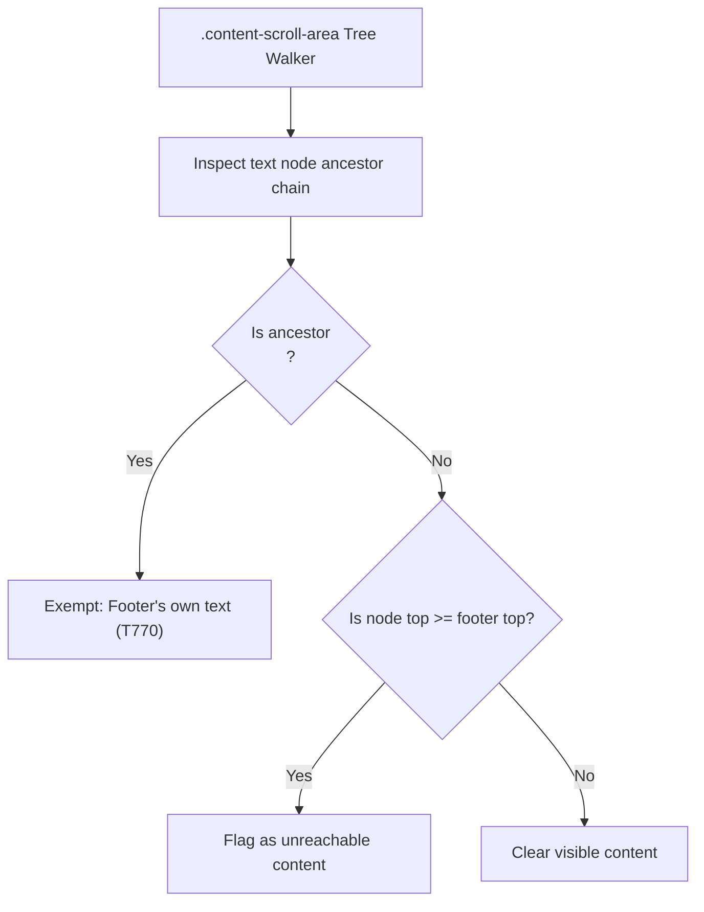

# T770 — Fix layout-matrix `measureAtBottom()` footer-assumption drift after T754

**Ticket:** [[T770]] · **Epic:** `design_system_sync` · **Repos:** `web`, `tooling`

## Summary

`apps/web/scripts/layout-matrix.mjs` provides the automated verification gate (`--check`) established in T261 for responsive layout compliance (AgDR-0054). `measureAtBottom()` inspects whether any text remains unreachable under the footer band when scrolled to maximum scroll depth.

In T754, `<footer>` was refactored from fixed chrome outside `.content-scroll-area` into an in-flow element inside `.content-scroll-area`. Because `measureAtBottom()` walked text nodes starting inside `.content-scroll-area`, it evaluated the footer's own text ("Webomage", "© 2026. All rights reserved.") as content overlapping the footer top. This produced a 100% false-positive rate (11/11 viewport pairs flagged as "bottom-unreachable") during live audits of `https://webomage.com/`.

## Resolution & Deliverables

1. **`apps/web/scripts/layout-matrix.mjs` (AC1):**
   - Updated `outOfFlow(el)` in `measureAtBottom()` to check ancestor chain and unconditionally skip text nodes where `e === footer`.
   - Real page content that fails to scroll clear of the footer continues to be caught.

2. **`apps/web/scripts/layout-matrix.test.mjs` (AC2):**
   - Added `shellT754` in-flow footer layout helper.
   - Added tests in `BOTTOM_CASES` verifying that in-flow footer text is exempt while real content occluded by an in-flow footer is caught (`atBottom=true unreachable=1`).
   - All 14/14 detector checks pass.

3. **Live Verification (AC3):**
   - Executed `layout-matrix.mjs --url https://webomage.com --pages /` across all 11 viewports.
   - 0 unreachable-text violations across all pairs (clearing the false 11/11 failure).
   - Saved report to `w0m-web/docs/reports/2026-11-18-t770-layout-matrix-footer-fixed.json` and `.md`.

## Walker Logic & Boundary Flow

## Verification Evidence

- `node apps/web/scripts/layout-matrix.test.mjs`: PASS (14/14 checks)
- `node apps/web/scripts/layout-matrix.mjs --url https://webomage.com --pages /`: PASS (11 pairs, 0 violations)
- `python3 scripts/reports_ticket_check.py`: PASS (163/163 valid)
