# T774 — Telegram & Meta Threads Hiring Search Hardening, Multi-Currency/Timezone Filters & Per-User Saved Defaults

- **Ticket:** `T774`
- **Status:** Verified and landed on `origin/beta` via `just session-complete T774` (after owner applied `T773` live migration; `just authz-probe --enforce` 70/70 GREEN)
- **OpenSpec:** `w0m-web/openspec/specs/social-hiring-search-hardening/spec.md` (`w0m-web/openspec/changes/archive/2026-11-18-t774-social-hiring-search-hardening/`)
- **Surfaces:** `apps/me`, `apps/cp`, `@webomage/lib/auth`, `@webomage/lib/connectors`, `just/estate.just`, `justfile`

## Executive Summary

Fixed the production `Unexpected token 'M', "Middleware"... is not valid JSON` failure and member credential vault bugs on `https://me.webomage.com` (`SocialHiringSearch.svelte` / `/api/jobs/social-search`), provisioned `CONNECTOR_TOKEN_KEY_VERSION` + `CONNECTOR_TOKEN_KEY_V1` across `sync-me-secrets`, `sync-cp-secrets`, and `deploy-me`, and upgraded Telegram & Meta Threads discovery cleanly for multi-currency (`USD/USDT/USDC`, `CAD`, `EUR`, `GBP`, `AUD`), multi-region timezones (`EST/Americas`, `Strict EST`, `EU/EMEA`, `APAC`, `Worldwide`), cross-stack expansion (`DevOps/SRE`, `Full-Stack`, `Backend`, `AI/ML`), and **per-user saved default search preferences** stored in `public.connections.profile_data.search_preferences` — so Aleksei can save `DevOps/SRE + Remote + USD + EST` as his default while any other user can search or save e.g. `Full-Stack + CAD + Americas` without hard restrictions.

## Root Causes Resolved

1. **Worker Secret Gap & Plain-Text Middleware Crash (`Unexpected token 'M', "Middleware"... is not valid JSON`):**
   - `webomage-me` and `webomage-cp` Cloudflare Workers lacked `CONNECTOR_TOKEN_KEY_VERSION` and `CONNECTOR_TOKEN_KEY_V1` in `just/estate.just`, while Vite inlined `CONNECTOR_TOKEN_KEY_VERSION: "1"` into `import.meta.env`.
   - Clicking **Save Member TG & Threads Credentials** without a token called `buildEncryptedTokenColumns("tg-member-channel-config", ...)` unconditionally, throwing `Missing encryption key environment variable CONNECTOR_TOKEN_KEY_V1 for key #1`.
   - `createAuthMiddleware` returned plain text `Middleware Error: ...` on `/api/*` 500s, causing `res.json()` in `SocialHiringSearch.svelte` to crash.
2. **Column-Level `GRANT SELECT` & Silent Write/Batching Defects (`social-search.ts`):**
   - `T442` revoked `authenticated` `SELECT` on `public.connections` ciphertext columns, causing member `GET`/`POST` reads to miss saved state; switched secret decryption to canonical `adminClient()` (`@webomage/lib/supabase-clients`, registered in `project/authz-admin-client-baseline.json`).
   - Added DB write error checks and consolidated up to 25 sequential `outreach_clips` upserts into one deduplicated batch upsert within Cloudflare's subrequest budget.
3. **Live Scraper Entity Decoding & Unopinionated Cross-Stack Discovery (`telegram-job-source.ts`, `threads-job-source.ts`):**
   - Telegram public preview HTML encodes `$` as `&#036;` and `!` as `&#33;`; `decodeHtmlEntities` omitted numeric character references, masking real salaries (`$90k` on `remoteok`, `$5k-10k/month` on `cryptojobslist`, `$80k–$150k` / `CAD 100k–135k` on `remotejobs`).
   - Replaced bare-link `cloud_devops_jobs` with verified active channels (`remoteok`, `remote_jobs_feed`, `remotejobs`, `remoteit`, `cryptojobslist`, `web3hiring`), generalized compensation/region extraction across `USD`/`CAD`/`EUR`/`GBP`/`AUD` and `Americas/EST`/`EU`/`APAC`/`Worldwide`, excluded English candidate-seeker & course/stats noise posts, and upgraded Threads discovery to high-yield 1–2 word `serp_type=default` + `tags` queries.

## Architecture & Request Flow

```mermaid
flowchart LR
  UI["SocialHiringSearch.svelte (readJsonSafe + Saved Defaults)"] -->|"GET / POST /api/jobs/social-search"| MW["createAuthMiddleware (JSON 500 on /api/*)"]
  MW --> API["social-search.ts (try/catch + origin + session)"]
  API -->|"action=save_preferences"| PREFS["connections.profile_data.search_preferences (RLS)"]
  API -->|"action=save_credentials"| CRYPTO["crypto.ts (explicit CONNECTOR_TOKEN_KEY_V1 + 503)"]
  API -->|"action=search"| TG["telegram-job-source.ts (&#036; decode + multi-stack channels)"]
  API -->|"action=search"| TH["threads-job-source.ts (hiring default/tags + seeker filter)"]
  TG --> FILTER["matchesSocialSearchFilters (Any/USD/CAD/EUR/GBP/AUD + TZ Regions)"]
  TH --> FILTER
```

## Key Changes

- **`w0m-web/packages/lib/src/auth/middleware.ts` & `packages/lib/src/connectors/crypto.ts`:** JSON `500` error boundary on `/api/*` routes with Bearer redaction; explicit `CONNECTOR_TOKEN_KEY_V1` read and `hasEncryptionKeyMaterial()`.
- **`just/estate.just` & `justfile`:** Syncs `CONNECTOR_TOKEN_KEY_VERSION` + `CONNECTOR_TOKEN_KEY_V1` in `sync-me-secrets`, `sync-cp-secrets`, and `deploy-me`.
- **`w0m-web/packages/lib/src/connectors/{telegram,threads}-job-source.ts`:** Numeric HTML entity decoding, multi-currency compensation parsing (`USD`/`USDT`/`USDC`/`CAD`/`EUR`/`GBP`/`AUD`), multi-region timezone classification, cross-stack keyword expansion (`DevOps/SRE`, `Full-Stack`, `Backend/AI`), seeker/noise exclusion, and subrequest-bounded discovery.
- **`w0m-web/apps/cp/src/pages/api/jobs/social-search.ts` & `project/authz-admin-client-baseline.json`:** Top-level JSON `try/catch`, safe-column RLS read + canonical `adminClient()` ciphertext decryption, fail-closed `503` for missing key on token submit, batched `outreach_clips` upsert, normalized multi-currency search output, and RLS-backed `action: "save_preferences"` / `"reset_preferences"` persistence that survives `save_credentials`.
- **`w0m-web/apps/cp/src/components/member/outreach/SocialHiringSearch.svelte`:** Neutral default state, auto-hydration of member saved defaults (`searchPreferences` + `localStorage` fallback), **Save as My Default**, Currency/Timezone `@webomage/ui` button cyclers, optional starter presets (`DevOps / SRE (USD · EST)` and `Full-Stack (CAD · Americas)`), multi-currency pay badges, and zero ticket identifiers in UI strings.

## Verification & Live Probe Results

- **Unit & API Suites (`vitest`):** `49/49` passing across 5 files (`middleware.spec.ts`, `connector-framework.spec.ts`, `telegram-job-source.test.ts`, `threads-job-source.test.ts`, `social-search.test.ts`).
- **Dual-Profile Live Discovery Probe:**
  - *Profile 1 (`DevOps SRE Kubernetes Terraform Platform`, `remoteOnly + USD + est_friendly`):* `19` Telegram matches (`remotejobs` `$80k` / `$130K–$150K/year`, `sysadmin_jobs` `2000$`, etc.) and live Threads `$50,000–$70,000` remote DevOps match.
  - *Profile 2 (`Full-Stack Cloud DevOps`, `remoteOnly + CAD + est_friendly`):* live Threads `CAD 45–50/hour` `americas_est` match (previously excluded).
- **Builds & Security/DS Gates:** Clean `oxlint`, sequential `apps/me` + `apps/cp` Astro builds, `just authz-admin-client --enforce`, `just secret-flow-check --enforce`, `just ui-ticket-leak-check`, `just ds-conformance`, `just mmd-validate`, `reports_ticket_check.py`, `lessons_check.py`, `just spec-policy-check`, and `just spec-drift`.
