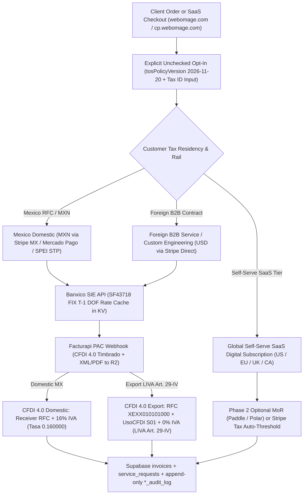

# T783 — Mexico & Global SaaS Business Automation Research Dossier (`AgDR-0059`)

- **Ticket:** [[T783]] (related: [[T781]], [[T782]], [[T351]], [[T373]], [[T630]])
- **Decision Record:** [`docs/decisions/AgDR-0059-mexico-global-saas-billing-tax-compliance.md`](../../docs/decisions/AgDR-0059-mexico-global-saas-billing-tax-compliance.md)
- **Date:** 2026-11-20
- **Jurisdiction Baseline:** Mexico (Playa del Carmen / Solidaridad, Quintana Roo, C.P. 77710) serving domestic Mexican (`MXN`) and global B2B/B2C (`USD`) customers.
- **Scope Disclaimer:** Technical and architectural compliance research grounded in Mexican federal statutes (LISR, LIVA, CFF, LFPDPPP DOF 2025-03-20, LFPC) and live `@wom` codebase inspection; not formal legal or certified public accounting (`Contador Público Certificado`) advice.

---

## Executive Summary

Following the deployment of the public legal compliance suite in [[T781]] (`/terms`, `/privacy`, `/refunds`, `/cancellation`, `/dpa`, `/sla`, `/cookies`, `/aviso-de-privacidad`, unchecked opt-in consent with `tosPolicyVersion = "2026-11-20"`, and Stripe Checkout `tax_id_collection.enabled = true`) and the 100/100 perimeter domain audit hardening in [[T782]], this dossier evaluates the **8 operational pillars** required to run Webomage as a fully automated SaaS and AI-assisted software engineering business from Mexico:

1. **Mexican Legal Entity & Tax Regime Strategy (SAT / LISR)**
2. **CFDI 4.0 Electronic Invoicing & 0% vs. 16% IVA Export Rules (LIVA Art. 29 Fracc. IV)**
3. **Global Tax & Payment Architecture (Direct Stripe + PAC vs. Merchant of Record)**
4. **Mexican Data Privacy After the March 20, 2025 LFPDPPP Reform (`SABG` replacing `INAI`)**
5. **PROFECO Consumer Protection, Recurring Subscriptions & Click-to-Cancel (`LFPC Art. 76 Bis`)**
6. **Banxico SIE FIX Exchange Rate Automation, SPEI / Mercado Pago Reconciliation & Dunning**
7. **AI Governance, Export Controls, Chargeback Evidence & Professional Liability (E&O)**
8. **Phased Technical Implementation Roadmap & Weighted Decision Matrix**

---

## Architecture & Billing Routing Topology

---

## Pillar 1 — Mexican Fiscal & Legal Entity Strategy (`RESICO` vs. `612` vs. `S.A.S.` / `S.A.P.I.`)

### 1.1 Statutory Rules (LISR Articles 113-E to 113-J)
- **Persona Física — Régimen Simplificado de Confianza (`RESICO`, Régimen `626`):**
  - **Effective ISR Rate:** **1.0% to 2.5%** on gross collected cash revenue (*flujo de efectivo*) up to the statutory cap of **3,500,000 MXN/year** (~$175,000–$200,000 USD/year).
  - **Strict Shareholder Incompatibility (LISR Art. 113-E Eighth Paragraph, Fracc. I):** An individual taxpayer **cannot** be a partner, shareholder, or member of *any* Mexican or foreign legal entity (*persona moral*, including a Mexican `S.A.S.`, `S. de R.L. de C.V.`, `S.A.P.I. de C.V.`, or a US LLC taxed as a corporation) while enrolled in RESICO Persona Física. Becoming a shareholder triggers retroactive removal from RESICO to the general regime (`612`) plus surcharges.
  - **Strict Cap Rule:** Exceeding 3.5M MXN in collected revenue within a calendar year forces transition to **Régimen `612` (Personas Físicas con Actividades Empresariales y Profesionales)** starting the month following the breach (progressive ISR up to **35%** on net profit).
- **Persona Moral (`S.A.S.`, `S. de R.L. de C.V.`, or `S.A.P.I. de C.V.`):**
  - Corporate ISR rate is a flat **30%** on net taxable profit (under RESICO Persona Moral up to 35M MXN, taxes are calculated on a cash-flow basis rather than accrual at invoice issuance, plus 10% dividend withholding on distributions to individuals).
  - Notice that `w0m-api/supabase/functions/_shared/mexican-payments.ts` (`L11`) currently sets `WOM_SPEI_BENEFICIARY = "Webomage S.A.P.I. de C.V."` as a default constant. Aligning the beneficiary name and emitting RFC with the active SAT `Constancia de Situación Fiscal` is mandatory before live CFDI 4.0 stamping.

| Attribute | Persona Física `RESICO (626)` | Persona Física `Empresarial (612)` | Persona Moral (`S.A.S.` / `S. de R.L.` / `S.A.P.I.`) |
|---|---|---|---|
| **Annual Revenue Ceiling** | **3.5M MXN** (~$180k USD) hard cap | Unlimited | `S.A.S.` ~7.1M MXN; `S. de R.L.` / `S.A.P.I.` unlimited |
| **Effective Income Tax (ISR)** | **1.0% – 2.5%** on gross cash collected | **1.92% – 35%** on net profit | **30%** on net profit + **10%** dividend tax |
| **Expense Deductions for ISR** | None needed (rate applies to gross; IVA credit still requires CFDI expenses) | Full authorized business deductions | Full corporate deductions |
| **Shareholder / Dual-Entity Allowed?** | **No** (LISR Art. 113-E Fracc. I forbids holding shares in any corporation) | **Yes** | **Yes** |
| **Mexican B2B Retención (Withholding)** | Mexican *Personas Morales* withhold **1.25% ISR** on payments to RESICO PF | 10% ISR withholding on *honorarios* (0% on commercial activity) | 0% ISR withholding between *Personas Morales* |

---

## Pillar 2 — SAT CFDI 4.0 Automation & 0% vs. 16% IVA on Software/Service Exports

### 2.1 0% IVA Export Qualification (`LIVA Art. 29 Fracc. IV` & `RLIVA Art. 61`)
Under **Article 29, Fraction IV, incisos d) and i) of the Ley del Impuesto al Valor Agregado (LIVA)**, the export of independent technical services, custom software development, cloud engineering, and data processing/information technology services qualifies for the **0% IVA rate (`Tasa 0.000000`)** instead of the 16% domestic IVA rate, **only when all four statutory conditions are met**:
1. **Foreign Utilization (`Aprovechamiento en el Extranjero`):** The service is contracted by a foreign resident without a permanent establishment in Mexico (`sin establecimiento permanente en México`) and the benefit is realized abroad.
2. **Traceable Foreign Payment Rail:** Payment MUST originate from a bank or financial institution account located **outside Mexico** (e.g., foreign card processed via Stripe or international SWIFT wire) and be deposited into the taxpayer's Mexican bank account.
   - **Critical SPEI Trap:** If a foreign client pays via a Mexican domestic SPEI intermediary in MXN from a Mexican bank CLABE without foreign origin traceability, SAT auditors can reclassify the payment as a domestic operation and assess **16% IVA** retroactively.
3. **Exact CFDI 4.0 Export Field Encoding (Anexo 20 SAT):**
   - `Rfc` (Receiver): **`XEXX010101000`** (generic foreign RFC)
   - `Nombre`: Legal name of the foreign customer
   - `DomicilioFiscalReceptor`: Issuer's Mexican postal code (`77710` for Playa del Carmen, Q. Roo)
   - `RegimenFiscalReceptor`: **`616`** (*Sin obligaciones fiscales*)
   - `UsoCFDI`: **`S01`** (*Sin efectos fiscales*)
   - `Exportacion`: **`01`** (*No aplica* — per SAT CFDI 4.0 Export Guide, code `02` is reserved for physical customs goods with a `Complemento de Comercio Exterior`; intangible services under LIVA Art. 29 Fracc. IV use `01` with explicit 0% IVA tax node)
   - `NumRegIdTrib` & `ResidenciaFiscal`: Populated when the foreign B2B customer supplies a tax ID (now collected via `tax_id_collection: { enabled: true }` in `w0m-api/supabase/functions/_shared/stripe-billing.ts` from [[T781]])
   - `ObjetoImp`: **`02`** (*Sí objeto de impuesto*) -> `Impuesto: 002 (IVA)`, `TipoFactor: Tasa`, `TasaOCuota: 0.000000`, `Importe: 0.00` (never `ObjetoImp: 01`, because 0% IVA is zero-rated, which preserves the right to recover 16% IVA paid on Mexican business expenses as a credit/`saldo a favor`).
4. **CFDI Global (`XAXX010101000`):** Domestic Mexican B2C customers who do not request an individual RFC invoice within the billing month are aggregated into a single monthly *CFDI Global* (`RFC: XAXX010101000`, `RegimenFiscalReceptor: 616`, `UsoCFDI: S01`, `16% IVA` separated).

### 2.2 PAC API Comparison (`Facturapi` vs. `Finkok` vs. `SW Sapien`)
- **Facturapi (`facturapi.io`):** Modern REST/JSON API, native Stripe integration, built-in self-serve customer invoicing portal (*Autofacturación* validating SAT `Constancia de Situación Fiscal` rules automatically), CSD `.cer`/`.key` vault management, and automatic PDF/XML generation.
- **Finkok / SW Sapien:** Direct wholesale SAT PACs (`~$0.20–$0.80 MXN/stamp`), ideal above 10,000 stamps/month, but require building custom XML canonicalization, XSLT chain signing, and a self-serve customer RFC portal from scratch.
- **Selected PAC for Phase 1–2:** **Facturapi** triggered asynchronously from `w0m-api/supabase/functions/stripe-webhook/` and `mercadopago-webhook/`, archiving signed `.xml` and `.pdf` files in Cloudflare R2 (`VAULT_R2` per `[[AgDR-0055]]`).

---

## Pillar 3 — Global SaaS Tax & Payment Stack (Direct Stripe + PAC vs. Merchant of Record)

### 3.1 Jurisdictional Thresholds for Remote Sellers (Mexican Seller -> Foreign Buyers)
- **United States (State Sales Tax Economic Nexus):** Under *South Dakota v. Wayfair*, remote SaaS sellers have **zero US state sales tax obligation** until crossing state-specific economic nexus thresholds (typically **$100,000 USD/year** or **200 transactions/year** in a single state, and ~25 states tax SaaS).
- **European Union (`VAT OSS` Non-Union Scheme) & UK:** Zero-threshold rule for B2C digital services (VAT due from the first euro/pound sold to an EU/UK consumer), whereas **B2B transactions with a valid EU/UK VAT ID (`tax_id_collection.enabled = true`) are exempt via Reverse Charge** (the business buyer self-assesses VAT).
- **Canada / LatAm Digital Services:** Canada federal GST/HST applies only after exceeding **$30,000 CAD/year** in B2C sales to Canadian consumers; B2B customers supplying a GST/HST number are exempt.

### 3.2 Weighted Decision Matrix: Payment & Tax Engine

| Criterion (Weight) | **O1 — Full MoR Only (`Paddle` / `Polar`) for All Revenue** | **O2 — Direct Stripe Only (Manual Tax & Manual SAT Portal CFDIs)** | **O3 — Hybrid Split: Direct Stripe + `tax_id_collection` + Facturapi PAC + Mercado Pago/SPEI (B2B & MX) + Triggered Stripe Tax / MoR (Global B2C SaaS)** |
|---|---|---|---|
| **Take-Rate & Unit Economics (`25%`)** | `4/10` (`5% + $0.50` even on $2,500–$15,000 B2B engineering contracts) | `9/10` (`2.9%–3.6% + fixed`, zero MoR fee) | **`9/10`** (Direct Stripe / `0%` SPEI on high-ticket B2B & MX; MoR/Stripe Tax only where needed) |
| **Mexican SAT CFDI 4.0 & 0% IVA Compliance (`25%`)** | `6/10` (Still requires issuing Mexican export CFDI 4.0 for MoR payout settlements) | `3/10` (Manual portal stamping fails at scale and risks month-end cutoffs) | **`10/10`** (Automated Facturapi CFDI 4.0 stamping per webhook + Banxico FIX rate) |
| **EU/UK/Global B2C VAT Compliance (`20%`)** | `10/10` (MoR acts as seller of record for B2C VAT) | `2/10` (Unregistered B2C VAT exposure in EU/UK) | **`9/10`** (B2B reverse-charge via `tax_id_collection` shipped in [[T781]]; B2C gated or routed via MoR/Stripe Tax) |
| **Codebase & Free-Tier Alignment (`15%`, `[[AgDR-0055]]`)** | `4/10` (Discards live `stripe-checkout` & `mercadopago-checkout` edge functions) | `7/10` (Uses existing code but leaves `19.5` FX hardcoded) | **`10/10`** (Extends `stripe-checkout`, `mercadopago-checkout`, R2 storage, and Supabase `invoices`) |
| **Dispute & Chargeback Protection (`15%`)** | `8/10` (Handled by MoR, strict AUP blocks security audits) | `6/10` (Manual evidence upload) | **`9/10`** (Automated evidence packet from `tosPolicyVersion`, `tosAcceptedAt`, and audit delivery logs) |
| **Weighted Total (`100%`)** | **`6.10 / 10`** | **`5.65 / 10`** | **`9.45 / 10` (Selected in `AgDR-0059`)** |

---

## Pillar 4 — Mexican Data Privacy After the March 20, 2025 LFPDPPP Reform (`SABG`)

- **Statutory Change:** Following the December 20, 2024 constitutional reform extinguishing `INAI` and the **new Ley Federal de Protección de Datos Personales en Posesión de los Particulares (LFPDPPP)** published in the *Diario Oficial de la Federación (DOF)* on **March 20, 2025**, oversight of private-sector personal data protection transferred to the **Secretaría Anticorrupción y Buen Gobierno (SABG)** (`transparencia.gob.mx`).
- **Live Estate Status (Verified in [[T781]]):**
  - `w0m-web/apps/web/src/pages/aviso-de-privacidad.astro` is live in Spanish (`lang="es"`), explicitly cites the March 20, 2025 DOF LFPDPPP reform and **SABG**, enumerates cross-border subprocessors (Cloudflare, Supabase, Stripe, Mercado Pago, Google Workspace, Resend) under LFPDPPP Art. 36, and defines the **20-business-day ARCO determination SLA** + **15-business-day execution window** (`privacy@webomage.com`).
  - All intake drawers (`ServiceActionOrderConfigurator.svelte`, `SecurityAuditWidget.svelte`, `BlueprintOrderFlow.svelte`, `AuditPricing.svelte`) enforce **unchecked opt-in consent (`$state(false)`)** and record `tosPolicyVersion` (`"2026-11-20"`) + `tosAcceptedAt` in `POST /api/security-audit`.

---

## Pillar 5 — PROFECO Consumer Protection & Click-to-Cancel (`LFPC Art. 76 Bis`)

- **5-Calendar-Day Pre-Renewal Notice (`LFPC Art. 76 Bis` & `76 Bis 1`):** For recurring subscriptions sold to Mexican consumers, the provider must notify the subscriber at least **5 calendar days prior to automatic renewal**, stating the renewal amount, billing date, and one-click cancellation link.
  - *Implementation Seam:* Trigger a Resend transactional notice on Stripe `invoice.upcoming` webhook (configured at 7 days pre-renewal) linking directly to the Stripe Customer Billing Portal or CP subscription cancellation control.
- **Immediate Click-to-Cancel:** Cancellation inside `cp.webomage.com` (and via the Stripe Customer Billing Portal) must require zero support-ticket friction and take effect at the end of the current paid period (`cancel_at_period_end: true`).
- **RPCA (Registro Público de Contratos de Adhesión):** Mandatory only for standardized consumer adhesion contracts targeted at regulated sectors; custom B2B engineering engagements and standard self-serve software terms governed by explicit opt-in consent (`tosPolicyVersion`) and the 14-day/5-business-day statutory revocation notice on `/refunds` (shipped in [[T781]]) satisfy LFPC Art. 56 & 76 Bis transparency requirements.

---

## Pillar 6 — Banxico SIE FIX FX Automation, SPEI Reconciliation & Dunning

- **Live Codebase Gap Identified:**
  - `w0m-api/supabase/functions/_shared/mexican-payments.ts` (`L9`) and `w0m-api/supabase/functions/mercadopago-checkout/index.ts` (`L100`) currently fall back to a static constant `DEFAULT_USD_TO_MXN_RATE = 19.5`.
- **Statutory FX Rule (`CFF Art. 20`):**
  - Every USD-denominated CFDI 4.0 invoice (`Moneda: USD`) MUST record the `TipoCambio` published by **Banco de México (Banxico)** in the *Diario Oficial de la Federación (DOF)* on the business day immediately preceding the transaction (`FIX T-1`, Banxico SIE Series **`SF43718`**).
- **Zero-Cost Cloudflare KV Cache Pattern (`[[AgDR-0055]]`):**
  - `w0m-cf` daily cron fetches `https://www.banxico.org.mx/SieAPIRest/service/v1/series/SF43718/datos/oportuno` using header `Bmx-Token`, caches the official `FIX` rate in Cloudflare KV (`FX_USD_MXN_DOF_TODAY`), and injects it into `mercadopago-checkout` and CFDI 4.0 `TipoCambio` generation before falling back to `DEFAULT_USD_MXN_EXCHANGE_RATE`.

---

## Pillar 7 — AI Governance, Sanctions Screening, Chargeback Evidence & E&O Liability

1. **Automated Chargeback Evidence Bundle (`Stripe Dispute API`):**
   - Because [[T781]] records `tosPolicyVersion` (`"2026-11-20"`), `tosAcceptedAt`, `visitorFingerprint`, and `metadata.tos_policy_version` on every checkout session, `stripe-webhook` can assemble an automated dispute defense packet containing: (a) timestamped Terms & Refund Policy version acceptance, (b) authenticated user session / IP / fingerprint verification, and (c) immutable audit report / deliverable access timestamps from Supabase `*_audit_log`.
2. **Contractual Liability Cap & E&O Insurance Threshold:**
   - `/terms` Section 10 (shipped in [[T781]]) caps aggregate liability at the fees paid in the preceding 12 months (or `$100 USD` for free-tier tools) and disclaims autonomous AI output warranties. Commercial Tech E&O + Cyber coverage ($1M–$2M USD limit via Chubb México or AIG México) is deferred until signing an enterprise B2B MSA exceeding **$50,000 USD/year** that contractually mandates a Certificate of Insurance (COI).

---

## Pillar 8 — Phased Implementation Roadmap

| Phase | Milestone | Scope & Code Seams | Status |
|---|---|---|---|
| **Phase 0** | **Public Legal Suite, Unchecked Consent & Stripe Tax ID Collection** | `/terms`, `/privacy`, `/refunds`, `/cancellation`, `/dpa`, `/sla`, `/cookies`, `/aviso-de-privacidad` (`SABG`), footer legal nav, unchecked `$state(false)` consent, `tosPolicyVersion`, Stripe `tax_id_collection` (`w0m-web`, `w0m-api`). | **Completed (`[[T781]]`)** |
| **Phase 0.5** | **100/100 Domain Security Audit & Linux Daily Audit Hardening** | RFC 7489/7208 subdomain DMARC/SPF inheritance (`100/100` Grade A across `webomage.com`, `me.`, `cp.`), Cloudflare DNSSEC/CAA/null-SPF Terraform IaC, zero `NOT RUN` daily audit (`w0m-web`, `w0m-api`, `scripts/`). | **Completed (`[[T782]]`)** |
| **Phase 1** | **Architectural Decision & Compliance Blueprint** | Codify `AgDR-0059` (`docs/decisions/AgDR-0059-mexico-global-saas-billing-tax-compliance.md`) and this dossier. | **Completed (`[[T783]]`)** |
| **Phase 2** | **Banxico SIE `SF43718` FX Sync & Facturapi CFDI 4.0 Webhook Stamping** | Replace static `19.5` fallback in `mexican-payments.ts` with Banxico SIE `SF43718` KV cache; wire `stripe-webhook` and `mercadopago-webhook` to stamp domestic (`16% IVA`) and export (`XEXX010101000`, `0% IVA` LIVA Art. 29-IV) CFDI 4.0 XML/PDFs into R2 (`VAULT_R2`). | **Planned (Phase 2 trigger: live SAT CSD `.cer`/`.key` upload)** |
| **Phase 3** | **PROFECO 5-Day Renewal Notice & Threshold-Triggered Stripe Tax / MoR** | Wire `invoice.upcoming` (7 days pre-renewal) Resend notification with one-click cancel link; enable Stripe Tax / MoR (`Paddle`/`Polar`) when EU/UK B2C self-serve SaaS tier launches. | **Planned (Phase 3 trigger: self-serve B2C recurring tier launch)** |
