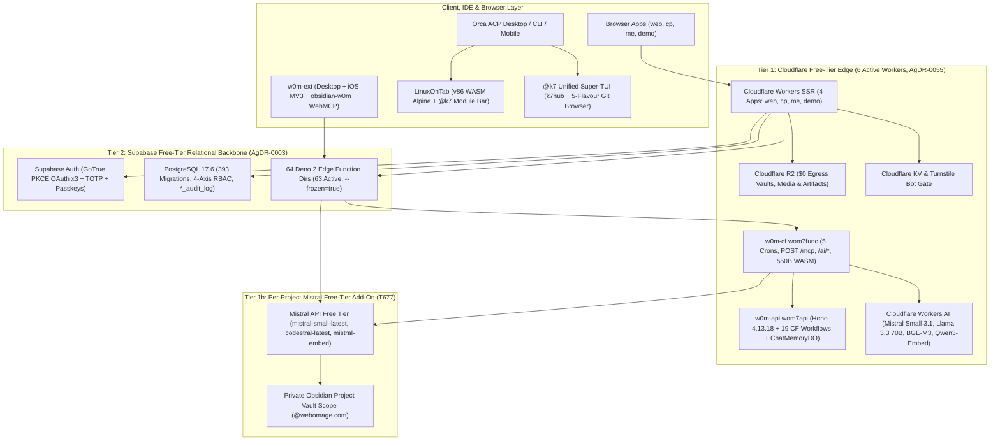

# `@wom` Estate Infrastructure & System Architecture

> **Canonical Workspace Root Architecture Entrypoint (`AGENTS.md`, `T680`, `T735`):** This document defines the live multi-repository topology, Free-Tier-First cloud hierarchy (`AgDR-0055`), per-project Mistral & Obsidian data isolation (`T677`), Orca ACP + `LinuxOnTab` + `@k7` module runtime (`T679`), and Infisical zero-`.env` deployment pipeline (`AgDR-0057`).
> **Full Layer-by-Layer Reference & Interactive Visual Explainer:** See [`docs/TECH-LANDSCAPE.md`](TECH-LANDSCAPE.md) and [`docs/visuals/w0m-tech-landscape-explainer.html`](visuals/w0m-tech-landscape-explainer.html) (`just tech-explainer`).

---

## 1. Estate Repository Topology

The `@wom` workspace root orchestrates **10 first-party git repositories** (`@wom` root + `7` core repos declared in `AGENTS.md`/`graph_health.REPOS` + `2` companion media/avatar repos `w0m-ava` and `w0m-clips`) alongside the sibling `@k7` Rust TUI toolchain and `w0m-pr/` upstream open-source forks:

| Repository / Surface | Primary Stack | Role & Live Runtime Boundary |
|---|---|---|
| **`@wom` (root)** | Python 3.12+ · `just` · Git | Estate control plane, `.tasks/T##.md` tracker, `STATE.md`, `LESSONS.md`, `scripts/session_complete.py`, `scripts/deploy_cert.py`, `scripts/w0m_kb_vector.py`, `scripts/w0m_prs.py` |
| **`w0m-web`** | Astro 7.3 SSR · Svelte 5 · Tailwind 4 | 4 Cloudflare Workers web apps (`web`, `cp`, `me`, `demo`; `AgDR-0056` retired `join` & `job` into `me`), 9 `packages/*` libraries, `@webomage/ui` design system (`25` canonical primitives), OpenSpec specs, and SDLC gates |
| **`w0m-api`** | Supabase (PostgreSQL 17.6 + Deno 2) · Hono | 393 SQL migrations, 4-axis RBAC (`public.wom_can`), 64 Supabase Edge Function dirs (`63` active + `trigger-hatchet-workflow/` stub, `--frozen=true`), Hono `4.13.18` (`>=4.13.16`) API worker (`wom7api`), `ChatMemoryDO` SQLite DO, and 19 Cloudflare Workflows |
| **`w0m-cf`** | Cloudflare Workers · Hono · Rust/WASM | Account-level cron triggers (`5/5` free-tier crons), stateless JSON-RPC `POST /mcp` endpoint, `#![no_std]` `w0m-wasm-utils` (`550 B`), `/ai/chat` & `/ai/embed` Workers AI + Mistral Free-Tier proxy (`wom7func`) |
| **`w0m-ext`** | Cross-Browser MV3 · TypeScript · WebMCP | Desktop & iOS Safari/Orion MV3 extensions (`Webomage Agent`, 11-platform `specEngine`, Orca loader `T710`), `obsidian-w0m` R2 delta sync plugin, authenticated HTTPS REST + ZeroClaw `:42617` (`:8008` WS retired per `AgDR-0039`) |
| **`w0m-sec`** | Python · Docker `--network none` · Pytest | Air-gapped containment runner, RFC 9116 `security.txt` audit, and `AgDR-0047` Touch-ID-gated bug-bounty governance |
| **`w0m-skills`** | Agent Skill Spec v1.0 · TypeScript (`tsx`) | 69 top-level canonical skills (`79` registry entries, `42` deployed, `71` `NVIDIA/SkillSpector v2.12.0`-scanned units), 7-dialect SDD (`GENERIC-SDLC-SET.md`), and Elephant-Goldfish (`egm-*`) workflows |
| **`w0m-mlx/w0m-mlx`** | Apple MLX (`mlx-rs` 0.33 + `omlx` 0.7.3) | Local Apple Silicon Metal inference (`wom7-mlx-rs` Rust server + `omlx` `:8888` + `mlx-vlm` `0.7.11` Gemma 4 & FLUX `:8080`) and `headroom` context compression |
| **`w0m-ava` · `w0m-clips`** | Media & Avatar Pipelines | Companion first-party avatar (`w0m-ava`) and media clip (`w0m-clips`) estate member repositories |
| **`@k7` (`k7hub` + 10 crates)** | Rust 1.95+ · `ratatui` · WASM | Unified `@k7` Super-TUI (`k7`) + 10 standalone top-level crates (`k7env`, `k7pwd`, `k7d`, `k7s`, `k7c` [6 Cargo packages], `k7llm`, `k7spec`, `k7sol`, `k7tg`, `k7kb`; `9/11` top-level / `8/10` non-hub on `ratatui`) + `k7hub::git_browser` (`T708`) |
| **`w0m-pr/*`** | Git Forks (`github.com/webomage/*`) | 23 local checkouts + 48 cataloged AI-tool forks (`63` distinct upstream forks; `AgDR-0058` 6-gate `w0m_prs.py`), incl. `SkillSpector`, `orca`, `linuxontab`, `graphify`, `headroom`, `omlx`, `mlx-rs`, `mlx-vlm`, `virtual-fido` |



---

## 2. Free-Tier-First Resource Hierarchy (`AgDR-0055`, `AgDR-0003`, `AgDR-0043`)

1. **Client-Side First (`$0` Server Compute):**
   - Compress images (`WebP`/`AVIF`), compute isomorphic FIPS 180-4 `SHA-256` content digests (`T734`), validate schemas, and execute disposable Linux sandboxes (`LinuxOnTab` `v86.wasm` in browser RAM) on the client before touching edge compute.
2. **Cloudflare Free Tier First (Edge Compute, Object Storage, Cache, Bot Gate & Primary AI):**
   - **Compute & SSR:** **6 active Cloudflare Workers** — 4 Astro 7.3 SSR Worker apps (`web`, `cp`, `me`, `demo`) + `wom7api` + `wom7func` (`100k req/day` free tier, Rust->WASM hot paths `< 300 KB` gzipped per `AgDR-0044`).
   - **Object & Vault Storage:** Cloudflare R2 (`10 GB/month` free, **$0 egress**) stores all Obsidian vault snapshots, resume PDFs, avatars, and media blobs under engagement prefix `engagements/eg-<slug>` (`r2://wom-engagement-vaults/engagements/eg-<slug>`).
   - **Primary AI:** Cloudflare Workers AI (`@cf/mistralai/mistral-small-3.1-24b-instruct`, `@cf/meta/llama-3.3-70b-instruct-fp8-fast`, `@cf/baai/bge-m3`, `@cf/qwen/qwen3-embedding-0.6b` 1024-dim; per-worker role & workflow rules are documented in `w0m-web/AGENTS.md`).
3. **Mistral Free-Tier Add-On & Per-Project Private Obsidian Scope (`T677`):**
   - Each enabled project declared in [`project/policies/clients-policy.json`](../project/policies/clients-policy.json) maps to a dedicated Mistral account `<project>@webomage.com` and an isolated Infisical secret `MISTRAL_API_KEY_<PROJECT_UPPER>`.
   - Enforces **tenant isolation** ([`scripts/mistral_project_scope.py`](../scripts/mistral_project_scope.py)): `allow_global_key_fallback = (pid == "w0m")` (`False` for external client projects, `True` for `w0m` core) and `cross_project_access = False`, confining Obsidian ACP and RAG context strictly to `w0m-web/projects/<slug>/vault`.
4. **Supabase Free Tier Second (Auth, RLS Metadata & Audit Ledger Only):**
   - Strictly reserved for GoTrue Authentication, PostgreSQL `17.6` RLS-governed relational rows (`500 MB` cap, local CLI DB `:54322`), and compact append-only `*_audit_log` triggers (`T614`). Never store binary blobs or high-frequency unauthenticated telemetry in Supabase.

---

## 3. Unified `@k7` Module System, Orca ACP & `LinuxOnTab` Runtime (`T677`, `T679`, `T708`)

### 3.1 Orca as First-Class Agent Client Protocol (ACP) Client
- Orca (`w0m-pr/orca`, `src/main/acp/`, listed on `agentclientprotocol.com/get-started/clients` via `PR #2770`) provides Desktop, CLI (`orcad` / `orca`), and Mobile ACP client surfaces driving `opencode`, `antigravity`, `claude`, `codex`, `gemini`, and `mistral-vibe` (`vibe`) across isolated Git worktrees.

### 3.2 Unified `@k7` Super-TUI (`k7hub`) & 10 Standalone Top-Level Crates (`16` Cargo Packages)
- `k7hub` (`../k7/k7hub/src/main.rs`, binary `k7`) unites the `@k7` Rust tool family (`k7env`, `k7pwd`, `k7d`, `k7s`, `k7c` + 5 FinOps/Terraform subcrates, `k7llm`, `k7spec`, `k7sol`, `k7tg`, `k7kb`; `9/11` top-level / `8/10` non-hub crates on `ratatui`) with a shared Infisical environment (`dev`/`beta`/`prod`), cross-module `k7pwd -> k7env` secret bus, and `k7hub::git_browser` (`wasm32-unknown-unknown` 5-flavour Git/LLM checkpoint browser mirrored in `apps/cp` via `CrewToolkitAndTabLinuxConsole.svelte`).

### 3.3 `LinuxOnTab` (`v86` WASM Alpine Linux) Browser & Orca Module Tabs
- Forked at `w0m-pr/linuxontab` (`github.com/webomage/linuxontab`, branch `feat/k7-orca-module-bar`) and served locally with mandatory `COOP`/`COEP` `SharedArrayBuffer` headers via [`scripts/linuxontab_serve.py`](../scripts/linuxontab_serve.py) (`just linuxontab-serve`).
- Supports `?autoboot=1&iso=alpine.iso&k7=<slug>&project=<project>&env=<env>` and an interactive `@k7` module bar (`#k7-module` + `#k7-run`) executing `/local/k7-module.sh` inside the Alpine guest.

---

## 4. Zero-`.env` Infisical Secret Pipeline & Tree-Set-Certified Deploy (`AgDR-0057`)

- **Zero `.env` Files in Production or Repo:** All secrets are stored in Infisical (`dev` and `beta` environments, `71` active keys in `beta` after `AES-256-GCM`-backed `T732` dead-key prune) and injected into processes via `infisical run --env=<env> --silent -- <cmd>`.
- **Operator Secret Tooling:** Generate CSPRNG secrets with `k7pwd` and audit/prune dead keys safely via `just env-usage-audit` and `just env-prune-dead`.
- **Isolated Agent Worktrees & Certified Landing (`AgDR-0032`, `AgDR-0057`):**
  - Agents work exclusively inside `~/.w0m/work/<name>/w0m` (`just agent-tree <name>`) and land via `just session-complete T##`, which runs **`16` verification gates in default `balance` mode** (`18` full gates in `wise`, `4` in `ultra`; `.w0m/sdlc.json -> session_wrapup.verification_gates`), certifies the estate tree-set digest (`scripts/deploy_cert.py`), pushes member repos before `@wom` root, fast-forwards the canonical checkout, and verifies `just state-check` last.

---

## 5. Quick Infrastructure & Knowledge Verification Commands

```bash
cd ~/Projects/'!self'/w0m
just preflight --fast
just kb-search "Cloudflare Workers 4-tier architecture"
just tech-explainer check
just state-check
```
