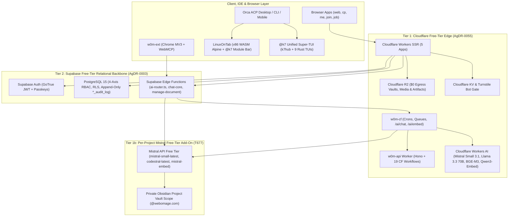

# `@wom` Estate Infrastructure & System Architecture

> **Canonical Workspace Root Architecture Entrypoint (`AGENTS.md`, `T680`):** This document defines the live multi-repository topology, Free-Tier-First cloud hierarchy (`AgDR-0055`), per-project Mistral & Obsidian data isolation (`T677`), Orca ACP + `LinuxOnTab` + `@k7` module runtime (`T679`), and Infisical zero-`.env` deployment pipeline (`AgDR-0057`).

---

## 1. Estate Repository Topology

The `@wom` workspace root orchestrates the first-party estate repositories alongside the `@k7` Rust TUI toolchain and `w0m-pr/` upstream open-source forks:

| Repository / Surface | Primary Stack | Role & Live Runtime Boundary |
|---|---|---|
| **`@wom` (root)** | Python 3.12+ · `just` · Git | Estate control plane, `.tasks/T##.md` tracker, `STATE.md`, `LESSONS.md`, `scripts/session_complete.py`, `scripts/deploy_cert.py`, `scripts/mistral_project_scope.py`, `scripts/w0m_prs.py` |
| **`w0m-web`** | Astro 6 SSR · Svelte 5 · Tailwind | 5 Cloudflare Workers web apps (`web`, `cp`, `me`, `join`, `job`), `@webomage/ui` design system (`25` canonical primitives), OpenSpec specs, and SDLC gates |
| **`w0m-api`** | Supabase (Postgres 15 + Deno) · Hono | 115+ SQL migrations, 4-axis RBAC (`public.wom_can`), 40+ Supabase Edge Functions, Hono API worker (`wom7api`), and 19 Cloudflare Workflows |
| **`w0m-cf`** | Cloudflare Workers · Rust/WASM | Account-level cron triggers (`5/5` free-tier crons), queues, `/ai/chat` & `/ai/embed` Workers AI + Mistral Free-Tier proxy (`wom7func`) |
| **`w0m-ext`** | Chrome MV3 · TypeScript · WebMCP | Webomage browser extensions (Job & Lead Clipper, Obsidian Vault Sync, WebMCP `navigator.modelContext` bridge) |
| **`w0m-sec`** | Python · Rust (`@k7`) · Nuclei | 4-tier security audit probes, RLS/RBAC verifiers, and cloud posture scanners |
| **`w0m-skills`** | Agent Skill Spec v1.0 · Python | Canonical `SKILL.md` registry (`w0m-skills/skills-registry.json`) and portable `w0m` CLI (`w0m_portable_cli.py`) |
| **`w0m-mlx/w0m-mlx`** | Apple MLX · Python · Rust | Local Apple Silicon inference (`mlx-community/gemma-4-26b-a4b-it-4bit`) and `oMLX`/`headroom` context compression |
| **`@k7` (`k7hub` + 9 crates)** | Rust · `ratatui` · `crossterm` · `tokio` | Unified `@k7` Super-TUI (`k7`) + 9 standalone/plugin modules (`k7env`, `k7pwd`, `k7d`, `k7s`, `k7c`, `k7llm`, `k7spec`, `k7sol`, `k7tg`) |
| **`w0m-pr/*`** | Git Forks (`github.com/webomage/*`) | First-class upstream forks including `orca` (`stablyai/orca`), `linuxontab` (`kilian-ai/linuxontab`), `agent-client-protocol`, `headroom`, `omlx`, `tart` |



---

## 2. Free-Tier-First Resource Hierarchy (`AgDR-0055`, `AgDR-0003`, `AgDR-0043`)

1. **Client-Side First (`$0` Server Compute):**
   - Compress images (`WebP`/`AVIF`), compute `SHA-256` content digests, validate schemas, and execute disposable Linux sandboxes (`LinuxOnTab` `v86.wasm` in browser RAM) on the client before touching edge compute.
2. **Cloudflare Free Tier First (Edge Compute, Object Storage, Cache, Bot Gate & Primary AI):**
   - **Compute & SSR:** 5 Astro SSR Worker apps + `wom7api` + `wom7func` (`100k req/day` free tier, Rust->WASM hot paths `< 300 KB` gzipped per `AgDR-0044`).
   - **Object & Vault Storage:** Cloudflare R2 (`10 GB/month` free, **$0 egress**) stores all Obsidian vault snapshots, resume PDFs, avatars, and media blobs (`projects/<slug>/vault` -> `r2://<slug>/`).
   - **Primary AI:** Cloudflare Workers AI (`@cf/mistralai/mistral-small-3.1-24b-instruct`, `@cf/meta/llama-3.3-70b-instruct-fp8-fast`, `@cf/baai/bge-m3`, `@cf/qwen/qwen3-embedding-0.6b` 1024-dim).
3. **Mistral Free-Tier Add-On & Per-Project Private Obsidian Scope (`T677`):**
   - Each enabled project in [`project/policies/clients-policy.json`](../project/policies/clients-policy.json) (`w0m`, `1945`, `artemio`, `servicios777`, `personaje0`, `bridgeroad`, `k7`, `solar`, `mantrabox`, `pandatransfer`) maps to a dedicated Mistral account `<project>@webomage.com` and an isolated Infisical secret `MISTRAL_API_KEY_<PROJECT_UPPER>`.
   - Enforces **fail-closed tenant isolation** ([`scripts/mistral_project_scope.py`](../scripts/mistral_project_scope.py)): non-`w0m` client projects have `allow_global_key_fallback = False` and `cross_project_access = False`, confining Obsidian ACP and RAG context strictly to `w0m-web/projects/<slug>/vault`.
4. **Supabase Free Tier Second (Auth, RLS Metadata & Audit Ledger Only):**
   - Strictly reserved for GoTrue Authentication, PostgreSQL 15 RLS-governed relational rows (`500 MB` cap), and compact append-only `*_audit_log` triggers (`T614`). Never store binary blobs or high-frequency unauthenticated telemetry in Supabase.

---

## 3. Unified `@k7` Module System, Orca ACP & `LinuxOnTab` Runtime (`T677`, `T679`)

### 3.1 Orca as First-Class Agent Client Protocol (ACP) Client
- Orca (`w0m-pr/orca`, `src/main/acp/`, listed on `agentclientprotocol.com/get-started/clients` via `PR #2770`) provides Desktop, CLI (`orcad` / `orca`), and Mobile ACP client surfaces driving `opencode`, `antigravity`, `claude`, `codex`, `gemini`, and `mistral-vibe` (`vibe`) across isolated Git worktrees.

### 3.2 Unified `@k7` Super-TUI (`k7hub`) & 9 Standalone Crates
- [`k7hub`](file:///home/aleksei/Projects/!self/k7/k7hub/k7hub/src/main.rs) (binary `k7`) unites all 9 `@k7` tools in a single multi-tab `ratatui` interface (`[1]` `env`, `[2]` `pwd`, `[3]` `vm`, `[4]` `k8s`, `[5]` `cloud`, `[6]` `llm`, `[7]` `spec`, `[8]` `sol`, `[9]` `tg`) with a shared Infisical environment (`dev`/`beta`/`prod`) and cross-module `k7pwd -> k7env` secret bus, while every crate remains runnable standalone (`k7 run <module>`).

### 3.3 `LinuxOnTab` (`v86` WASM Alpine Linux) Browser & Orca Module Tabs
- Forked at `w0m-pr/linuxontab` (`github.com/webomage/linuxontab`, branch `feat/k7-orca-module-bar`) and served locally with mandatory `COOP`/`COEP` `SharedArrayBuffer` headers via [`scripts/linuxontab_serve.py`](../scripts/linuxontab_serve.py) (`just linuxontab-serve`).
- Supports `?autoboot=1&iso=alpine.iso&k7=<slug>&project=<project>&env=<env>` and an interactive `@k7` module bar (`#k7-module` + `#k7-run`) executing `/local/k7-module.sh` inside the Alpine guest.

---

## 4. Zero-`.env` Infisical Secret Pipeline & Tree-Set-Certified Deploy (`AgDR-0057`)

- **Zero `.env` Files in Production or Repo:** All secrets are stored in Infisical (`dev` and `beta` environments, workspace `87a1718d-17c6-4c5e-b0c1-f8bb2fd9d13c`) and injected into processes via `infisical run --env=<env> --silent -- <cmd>`.
- **Operator Secret Tooling:** Generate CSPRNG secrets with `k7pwd` (`/dev/urandom` 24-char alnum+sym, `openssl rand -base64 16`, `diceware`, `prefixed-api-key`) and audit/bind Infisical profiles with `k7env` and `just mistral-scope-status`.
- **Isolated Agent Worktrees & Certified Landing (`AgDR-0032`, `AgDR-0057`):**
  - Agents work exclusively inside `~/.w0m/work/<name>/w0m` (`just agent-tree <name>`) and land via `just session-complete T##`, which runs 14 verification gates, certifies the estate tree-set digest (`scripts/deploy_cert.py`), pushes member repos before `@wom` root, fast-forwards the canonical checkout, and verifies `just state-check` last.

---

## 5. Quick Infrastructure Verification Commands

Verify estate preflight, per-project Mistral/Obsidian isolation, and `LinuxOnTab` readiness:

```bash
cd ~/Projects/'!self'/w0m
just preflight --fast
just mistral-scope-status
just linuxontab-serve 8770 --dry-run
just state-check
```
