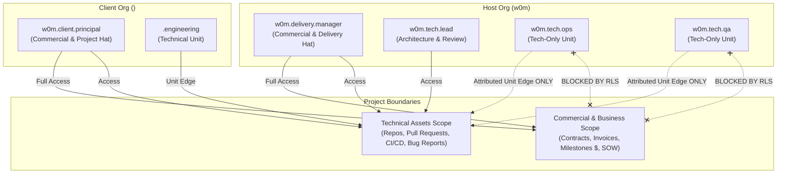

# AgDR-0020 — Guild Taxonomy as Decorative Theme, QA & DevOps as Tech-Only Units, and Hierarchical `<realm>.<area>.<role>` Office Keys

> **Amended by [[AgDR-0028]] decision 10 (2026-09-26):** `<realm>.<area>.<role>` stays for unit slots (realm = org:
> `w0m.talent.recruiting`, `webomage.fin.principal`); offices become one generic catalogue; engagement hats are
> addressed `<contractor>.<engagement>.<client>.<role>`; the w0m-realm delivery offices retire.

## Y-statement

> In the context of **[[T117]]'s finalization and Phase 2 Client Epic scoping**, facing **(a) the pending guild taxonomy lock (AC10), (b) scope ambiguity for QA and DevOps actors on client projects, and (c) unstandardized office key naming**, we decided:
> 1. **The guild progression taxonomy (`recruit → gladiator → legioner → master`) is strictly a presentation/decorative theme naming layer**, completely isolated from PostgreSQL identity schemas (`user_roles.role` remains the canonical 6: `admin, manager, member, client, recruit, anon`);
> 2. **QA and DevOps hats are tech-only units, not members, and do NOT have access to business or commercial details of the project** (no access to contracts, invoices, milestones financial amounts, client proposals, or payout rates); their reach is confined to technical assets (`project_repos`, CI/CD, deployment targets, bug reports, test suites) via attributed `public.unit_edges`;
> 3. **Office keys adopt the standardized hierarchical `<realm>.<area>.<role>` syntax** (e.g. `w0m.fin.principal`, `w0m.talent.recruiting`, `w0m.delivery.manager`, `w0m.tech.lead`, `w0m.tech.ops`, `w0m.tech.qa`, `<client>.tech.lead`),
> to achieve **strict least-privilege security between technical staff and commercial project data, consistent dot-notated hierarchy across all RBAC axes, and an unburdened core identity model**, accepting **that legacy offices in `public.offices` will be transitioned to the 3-part namespace, and `lexicon-lint` enforces this boundary**.

---

## Context

Following the application of [[AgDR-0019]] and migration `20260914180000` (which purged dead guild and agent roles from `user_roles.role` and established `public.profiles.subject_type`), three questions remained for final closure:
1. **AC10 (Guild Taxonomy):** The Roman/Greek guild taxonomy (`gladiator`, `legioner`, `master`) sat in limbo.
2. **Technical Staff vs. Commercial Exposure:** When client organizations and host delivery teams collaborate, QA engineers and DevOps personnel require access to code, build logs, and test infrastructure, but exposing contracts, pricing, and commercial milestone values violates multi-tenant commercial confidentiality.
3. **Office Key Syntax:** Axis 3 offices had a mix of two-part (`tech.lead`, `accounting.principal`) and bare terms without an explicit `<realm>` namespace.

---

## Decision Details

### 1. Guild Progression as an Opt-In Decorative Theme

The identity axis (`public.user_roles.role`) is permanently locked to the 6 canonical roles:
* `admin`
* `manager`
* `member`
* `client`
* `recruit`
* `anon`

The progression sequence:
$$\text{recruit} \longrightarrow \text{gladiator} \longrightarrow \text{legioner} \longrightarrow \text{master}$$
is classified strictly as a **Gamification Theme Presentation Layer**:
* In the database, progression is tracked via clean seniority/advancement levels (e.g. `level 0` to `level 3` or `applicant → trial → active → senior`).
* The UI renders these as `recruit`, `gladiator`, `legioner`, and `master` **only** when `isGamificationThemeEnabled()` evaluates to `true` (controlled via `projects.gamification_enabled` or user preference).
* `just lexicon-lint` checks that database schemas never contain `gladiator` or `legioner` as identity role enums.

### 2. QA & DevOps as Tech-Only Functional Units

QA and DevOps entities are defined as **Tech-Only Functional Units** (`<org>.qa`, `<org>.devops`, or `<org>.system`), rather than general project members:

#### Access Boundary Contract:
* **Denied Surfaces (Commercial Details):**
  * `public.contracts` and financial terms.
  * `public.client_milestones.amount_usd` and commercial deliverables.
  * `public.invoices` and payout ledgers.
  * Proposals, client communications, and business rates.
* **Permitted Surfaces (Technical Assets):**
  * Source code repositories and branches (`public.project_repos`).
  * Bug reports, reproduction steps, and test triage (`public.bug_reports`).
  * CI/CD build logs, worker deployment configurations, and runtime monitoring.
  * Technical architectural blueprints (`public.blueprints`).
* **Enforcement:** Enforced via `public.wom_can_uri()` and `public.unit_edges` where `granted_capabilities` contains technical actions (`repo.read`, `deploy.execute`, `test.run`, `bug.report`) but lacks commercial capabilities (`contract.view`, `billing.view`, `milestone.approve`).

### 3. Hierarchical `<realm>.<area>.<role>` Office Syntax

All office keys in `public.offices` and `public.office_capabilities` adopt the three-tier dot-notated hierarchy:

$$\langle\text{realm}\rangle.\langle\text{area}\rangle.\langle\text{role}\rangle$$

| Legacy Key | Standardized Key | Realm | Area | Role |
|---|---|---|---|---|
| `accounting.principal` | `w0m.fin.principal` | `w0m` | `fin` | `principal` |
| `talent.recruiting` | `w0m.talent.recruiting` | `w0m` | `talent` | `recruiting` |
| `talent.trainer` | `w0m.talent.trainer` | `w0m` | `talent` | `trainer` |
| `project.manager` | `w0m.delivery.manager` | `w0m` | `delivery` | `manager` |
| `tech.lead` | `w0m.tech.lead` | `w0m` | `tech` | `lead` |
| `tech.ops` | `w0m.tech.ops` | `w0m` | `tech` | `ops` |
| *New* | `w0m.tech.qa` | `w0m` | `tech` | `qa` |
| *New* | `w0m.tech.program` | `w0m` | `tech` | `program` |
| `client.principal` | `<client_slug>.client.principal` | `<client_slug>` | `client` | `principal` |

---

## Consequences

1. **AC10 is officially closed:** The guild taxonomy debate is resolved by detaching it entirely from the database and treating it as a theme presentation option.
2. **Phase 2 Client Technical Collaboration is clear:** Client QA or DevOps personnel do not need invitations into client commercial workspaces; they connect to the project's technical scope via attributed `unit_edges`.
3. **Office Namespace Parity:** The office catalog matches the `<org>.<unit>` grammar established in [[AgDR-0019]].
