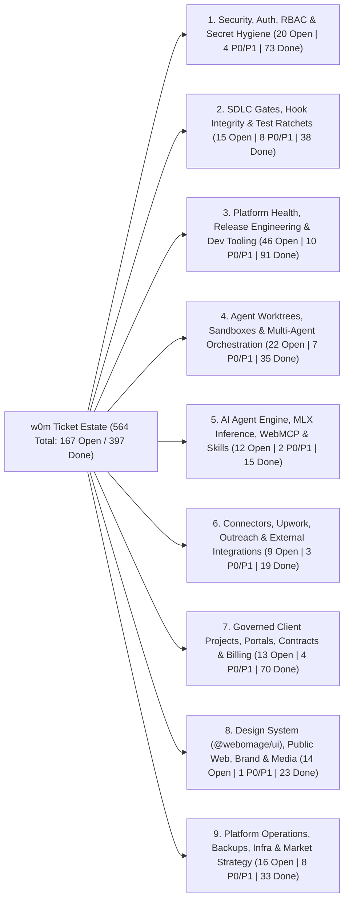

# w0m Estate Ticket Classification & Domain Taxonomy (T1–T564)

> [!NOTE]
> **Estate Totals (as of 2026-10-21):** **564 total tickets** across `.tasks/T1.md`–`.tasks/T564.md` — **397 Done (`✅`)** and **167 Open (`158 queued`, `8 paused`, `1 blocked`)** classified across **9 canonical architectural areas**.

## 1. Architectural Area Distribution

## 2. Summary Matrix by Area

| Area | Open | P0 | P1 | P2 | P3 | Paused / Blocked | Done (`✅`) | Total |
|---|---:|---:|---:|---:|---:|---:|---:|---:|
| **1. Security, Auth, RBAC & Secret Hygiene** | **20** | 1 | 3 | 15 | 1 | 3 | 73 | 93 |
| **2. SDLC Gates, Hook Integrity & Test Ratchets** | **15** | 0 | 8 | 7 | 0 | 0 | 38 | 53 |
| **3. Platform Health, Release Engineering & Dev Tooling** | **46** | 0 | 10 | 25 | 11 | 0 | 91 | 137 |
| **4. Agent Worktrees, Sandboxes & Multi-Agent Orchestration** | **22** | 0 | 7 | 14 | 1 | 2 | 35 | 57 |
| **5. AI Agent Engine, MLX Inference, WebMCP & Skills** | **12** | 0 | 2 | 8 | 2 | 0 | 15 | 27 |
| **6. Connectors, Upwork, Outreach & External Integrations** | **9** | 0 | 3 | 5 | 1 | 2 | 19 | 28 |
| **7. Governed Client Projects, Portals, Contracts & Billing** | **13** | 0 | 4 | 9 | 0 | 1 | 70 | 83 |
| **8. Design System (@webomage/ui), Public Web, Brand & Media** | **14** | 0 | 1 | 12 | 1 | 0 | 23 | 37 |
| **9. Platform Operations, Backups, Infra & Market Strategy** | **16** | 0 | 8 | 6 | 2 | 1 | 33 | 49 |
| **Total** | **167** | **1** | **46** | **101** | **19** | **9** | **397** | **564** |

> [!TIP]
> **Ready-to-Close / Tracker Sync Candidates Discovered During Audit:**
> - **[T451](file:///home/aleksei/Projects/!self/w0m/.tasks/T451.md)** (`/admin/vaults 500s: node:fs vault reading inside workerd`): Fixed and deployed today in `wom7web@b5790ff0` (`import.meta.glob` + zero-DOM sanitizer in `vault-reader.ts` / `vault-parser.ts`) — ready to flip to `done`.
> - **[T48](file:///home/aleksei/Projects/!self/w0m/.tasks/T48.md)** & **[T170](file:///home/aleksei/Projects/!self/w0m/.tasks/T170.md)**: Already `status: done` in `.tasks/` frontmatter; only their `TASKS.md` table rows still show `💤`/`⚪`.

---

## 3. Complete Open Ticket Catalogue by Area (167 Open Tickets)

### 1. Security, Auth, RBAC & Secret Hygiene (20 Open · 73 Done)

| Ticket | Prio | Status | Repos | Epic | ACs | Blocked By | Title |
|---|---|---|---|---|---|---|---|
| [T504](file:///home/aleksei/Projects/!self/w0m/.tasks/T504.md) | **P0** | 💤 paused | `web, api` | `security-rbac-hardening` | `2/6` | — | the leaked Gemini key, and the rest of what was committed with it |
| [T454](file:///home/aleksei/Projects/!self/w0m/.tasks/T454.md) | **P1** | ⚪ queued | `web` | `security-rbac-hardening` | `0/4` | T453 | MFA for non-admin accounts |
| [T466](file:///home/aleksei/Projects/!self/w0m/.tasks/T466.md) | **P1** | ⚪ queued | `web` | `security-rbac-hardening` | `0/6` | — | Every user-guide story has a UI test and an interactive Jam walkthrough |
| [T475](file:///home/aleksei/Projects/!self/w0m/.tasks/T475.md) | **P1** | ⚪ queued | `web, api` | `security-rbac-hardening` | `0/5` | — | Biometric hardware anchor for @wom/kyc and compliance profiles |
| [T17](file:///home/aleksei/Projects/!self/w0m/.tasks/T17.md) | P2 | ⚪ queued | `web` | `security-rbac-hardening` | `0/2` | — | Purge .env.bak from wom7web git history |
| [T28](file:///home/aleksei/Projects/!self/w0m/.tasks/T28.md) | P2 | ⚪ queued | `infra` | `platform-security-integrations` | `0/2` | — | @webomage.com mailbox provisioning |
| [T31](file:///home/aleksei/Projects/!self/w0m/.tasks/T31.md) | P2 | 💤 paused | `web, infra` | `security-rbac-hardening` | `2/4` | — | Test admin hygiene |
| [T32](file:///home/aleksei/Projects/!self/w0m/.tasks/T32.md) | P2 | 💤 paused | `web, infra` | `security-rbac-hardening` | `3/4` | — | Rotate leaked Supabase postgres superuser password |
| [T65](file:///home/aleksei/Projects/!self/w0m/.tasks/T65.md) | P2 | ⚪ queued | `api, web` | `platform-security-integrations` | `0/3` | — | Gitpod Cloud Developer Workspaces |
| [T66](file:///home/aleksei/Projects/!self/w0m/.tasks/T66.md) | P2 | ⚪ queued | `ext` | `platform-security-integrations` | `0/7` | — | Indeed Profile Form-Fill Helpers (wom7ext) |
| [T347](file:///home/aleksei/Projects/!self/w0m/.tasks/T347.md) | P2 | ⚪ queued | `web, api` | `multi-hat-active-context` | `0/7` | — | a bug display, routed by hat |
| [T433](file:///home/aleksei/Projects/!self/w0m/.tasks/T433.md) | P2 | ⚪ queued | `sec, web` | `wom7sec-audit-toolchain` | `0/8` | — | Bug-bounty programme: w0m disclosure posture (security.txt, safe harbor, diodb) and a human-gated hunting pilot |
| [T459](file:///home/aleksei/Projects/!self/w0m/.tasks/T459.md) | P2 | ⚪ queued | `web, api` | `security-rbac-hardening` | `0/3` | T458 | Research: merge a personal org into a company org |
| [T460](file:///home/aleksei/Projects/!self/w0m/.tasks/T460.md) | P2 | ⚪ queued | `web, api` | `security-rbac-hardening` | `0/3` | T458 | Research: group training in one engagement |
| [T462](file:///home/aleksei/Projects/!self/w0m/.tasks/T462.md) | P2 | ⚪ queued | `web, api, func` | `security-rbac-hardening` | `0/3` | — | Research: ground Architect Mode in the indexed knowledge |
| [T479](file:///home/aleksei/Projects/!self/w0m/.tasks/T479.md) | P2 | ⚪ queued | `web` | `security-rbac-hardening` | `0/4` | — | HttpOnly island token hardening |
| [T489](file:///home/aleksei/Projects/!self/w0m/.tasks/T489.md) | P2 | ⚪ queued | `api, web` | `security-rbac-hardening` | `0/2` | — | Live test-team provisioning & production non-founder verification (confirm-gated) |
| [T524](file:///home/aleksei/Projects/!self/w0m/.tasks/T524.md) | P2 | ⚪ queued | `api` | `security-rbac-hardening` | `0/4` | — | Supabase default grants: research, then decide |
| [T547](file:///home/aleksei/Projects/!self/w0m/.tasks/T547.md) | P2 | ⚪ queued | `web` | `security-rbac-hardening` | `0/3` | — | credential-probe red: apps/cp/src/pages/api/profile/services.ts |
| [T490](file:///home/aleksei/Projects/!self/w0m/.tasks/T490.md) | P3 | ⚪ queued | `ext, web` | `security-rbac-hardening` | `0/4` | — | the extension cannot receive the admin broadcast it was built for |

Completed in this area (73 tickets)

[T18](file:///home/aleksei/Projects/!self/w0m/.tasks/T18.md), [T19](file:///home/aleksei/Projects/!self/w0m/.tasks/T19.md), [T35](file:///home/aleksei/Projects/!self/w0m/.tasks/T35.md), [T39](file:///home/aleksei/Projects/!self/w0m/.tasks/T39.md), [T49](file:///home/aleksei/Projects/!self/w0m/.tasks/T49.md), [T52](file:///home/aleksei/Projects/!self/w0m/.tasks/T52.md), [T53](file:///home/aleksei/Projects/!self/w0m/.tasks/T53.md), [T54](file:///home/aleksei/Projects/!self/w0m/.tasks/T54.md), [T63](file:///home/aleksei/Projects/!self/w0m/.tasks/T63.md), [T64](file:///home/aleksei/Projects/!self/w0m/.tasks/T64.md), [T67](file:///home/aleksei/Projects/!self/w0m/.tasks/T67.md), [T68](file:///home/aleksei/Projects/!self/w0m/.tasks/T68.md), [T87](file:///home/aleksei/Projects/!self/w0m/.tasks/T87.md), [T100](file:///home/aleksei/Projects/!self/w0m/.tasks/T100.md), [T102](file:///home/aleksei/Projects/!self/w0m/.tasks/T102.md), [T111](file:///home/aleksei/Projects/!self/w0m/.tasks/T111.md), [T117](file:///home/aleksei/Projects/!self/w0m/.tasks/T117.md), [T120](file:///home/aleksei/Projects/!self/w0m/.tasks/T120.md), [T121](file:///home/aleksei/Projects/!self/w0m/.tasks/T121.md), [T122](file:///home/aleksei/Projects/!self/w0m/.tasks/T122.md), [T123](file:///home/aleksei/Projects/!self/w0m/.tasks/T123.md), [T124](file:///home/aleksei/Projects/!self/w0m/.tasks/T124.md), [T126](file:///home/aleksei/Projects/!self/w0m/.tasks/T126.md), [T137](file:///home/aleksei/Projects/!self/w0m/.tasks/T137.md), [T138](file:///home/aleksei/Projects/!self/w0m/.tasks/T138.md), [T139](file:///home/aleksei/Projects/!self/w0m/.tasks/T139.md), [T159](file:///home/aleksei/Projects/!self/w0m/.tasks/T159.md), [T175](file:///home/aleksei/Projects/!self/w0m/.tasks/T175.md), [T196](file:///home/aleksei/Projects/!self/w0m/.tasks/T196.md), [T198](file:///home/aleksei/Projects/!self/w0m/.tasks/T198.md), [T199](file:///home/aleksei/Projects/!self/w0m/.tasks/T199.md), [T200](file:///home/aleksei/Projects/!self/w0m/.tasks/T200.md), [T201](file:///home/aleksei/Projects/!self/w0m/.tasks/T201.md), [T202](file:///home/aleksei/Projects/!self/w0m/.tasks/T202.md), [T205](file:///home/aleksei/Projects/!self/w0m/.tasks/T205.md), [T206](file:///home/aleksei/Projects/!self/w0m/.tasks/T206.md), [T207](file:///home/aleksei/Projects/!self/w0m/.tasks/T207.md), [T208](file:///home/aleksei/Projects/!self/w0m/.tasks/T208.md), [T210](file:///home/aleksei/Projects/!self/w0m/.tasks/T210.md), [T213](file:///home/aleksei/Projects/!self/w0m/.tasks/T213.md), [T233](file:///home/aleksei/Projects/!self/w0m/.tasks/T233.md), [T244](file:///home/aleksei/Projects/!self/w0m/.tasks/T244.md), [T310](file:///home/aleksei/Projects/!self/w0m/.tasks/T310.md), [T311](file:///home/aleksei/Projects/!self/w0m/.tasks/T311.md), [T313](file:///home/aleksei/Projects/!self/w0m/.tasks/T313.md), [T314](file:///home/aleksei/Projects/!self/w0m/.tasks/T314.md), [T315](file:///home/aleksei/Projects/!self/w0m/.tasks/T315.md), [T317](file:///home/aleksei/Projects/!self/w0m/.tasks/T317.md), [T319](file:///home/aleksei/Projects/!self/w0m/.tasks/T319.md), [T320](file:///home/aleksei/Projects/!self/w0m/.tasks/T320.md), [T327](file:///home/aleksei/Projects/!self/w0m/.tasks/T327.md), [T329](file:///home/aleksei/Projects/!self/w0m/.tasks/T329.md), [T336](file:///home/aleksei/Projects/!self/w0m/.tasks/T336.md), [T337](file:///home/aleksei/Projects/!self/w0m/.tasks/T337.md), [T352](file:///home/aleksei/Projects/!self/w0m/.tasks/T352.md), [T354](file:///home/aleksei/Projects/!self/w0m/.tasks/T354.md), [T356](file:///home/aleksei/Projects/!self/w0m/.tasks/T356.md), [T359](file:///home/aleksei/Projects/!self/w0m/.tasks/T359.md), [T363](file:///home/aleksei/Projects/!self/w0m/.tasks/T363.md), [T381](file:///home/aleksei/Projects/!self/w0m/.tasks/T381.md), [T382](file:///home/aleksei/Projects/!self/w0m/.tasks/T382.md), [T448](file:///home/aleksei/Projects/!self/w0m/.tasks/T448.md), [T453](file:///home/aleksei/Projects/!self/w0m/.tasks/T453.md), [T457](file:///home/aleksei/Projects/!self/w0m/.tasks/T457.md), [T463](file:///home/aleksei/Projects/!self/w0m/.tasks/T463.md), [T465](file:///home/aleksei/Projects/!self/w0m/.tasks/T465.md), [T468](file:///home/aleksei/Projects/!self/w0m/.tasks/T468.md), [T469](file:///home/aleksei/Projects/!self/w0m/.tasks/T469.md), [T471](file:///home/aleksei/Projects/!self/w0m/.tasks/T471.md), [T472](file:///home/aleksei/Projects/!self/w0m/.tasks/T472.md), [T497](file:///home/aleksei/Projects/!self/w0m/.tasks/T497.md), [T506](file:///home/aleksei/Projects/!self/w0m/.tasks/T506.md), [T515](file:///home/aleksei/Projects/!self/w0m/.tasks/T515.md)

### 2. SDLC Gates, Hook Integrity & Test Ratchets (15 Open · 38 Done)

| Ticket | Prio | Status | Repos | Epic | ACs | Blocked By | Title |
|---|---|---|---|---|---|---|---|
| [T43](file:///home/aleksei/Projects/!self/w0m/.tasks/T43.md) | **P1** | ⚪ queued | `all` | `spec-authoring-standard` | `0/7` | — | Full-observability logging strategy |
| [T225](file:///home/aleksei/Projects/!self/w0m/.tasks/T225.md) | **P1** | ⚪ queued | `api` | `sdlc-pipeline-hooks` | `0/6` | — | the default embedding model does not exist |
| [T241](file:///home/aleksei/Projects/!self/w0m/.tasks/T241.md) | **P1** | ⚪ queued | `web` | `gate-integrity` | `0/6` | — | `--scope-diff` reaches one check and not the one three lines below it |
| [T278](file:///home/aleksei/Projects/!self/w0m/.tasks/T278.md) | **P1** | ⚪ queued | `web, tooling` | `gate-integrity` | `0/6` | — | a green that means nothing, on the surface clients sign in to |
| [T385](file:///home/aleksei/Projects/!self/w0m/.tasks/T385.md) | **P1** | ⚪ queued | `web, api, tooling` | `gate-integrity` | `0/6` | — | Remediate failing client profile and inventory test suites, and promote drop-callers gate to blocking |
| [T386](file:///home/aleksei/Projects/!self/w0m/.tasks/T386.md) | **P1** | ⚪ queued | `web, api, tooling` | `sdlc-pipeline-hooks` | `0/6` | — | Unify git hooks architecture under single just runner contract and eliminate husky vs pre-commit shadowing |
| [T408](file:///home/aleksei/Projects/!self/w0m/.tasks/T408.md) | **P1** | ⚪ queued | `web, api, tooling` | `gate-integrity` | `0/5` | — | A commit from a fresh git worktree runs zero hooks |
| [T531](file:///home/aleksei/Projects/!self/w0m/.tasks/T531.md) | **P1** | ⚪ queued | `tooling` | `gate-integrity` | `0/6` | — | Several agents, one estate |
| [T104](file:///home/aleksei/Projects/!self/w0m/.tasks/T104.md) | P2 | ⚪ queued | `web` | `gate-integrity` | `0/6` | — | Dev-tooling that silently doesn't run |
| [T129](file:///home/aleksei/Projects/!self/w0m/.tasks/T129.md) | P2 | ⚪ queued | `web, api, skills` | `gate-integrity` | `0/5` | — | SDLC structural enforcement |
| [T276](file:///home/aleksei/Projects/!self/w0m/.tasks/T276.md) | P2 | ⚪ queued | `web` | `gate-integrity` | `0/7` | — | name the seam before writing the scenarios |
| [T328](file:///home/aleksei/Projects/!self/w0m/.tasks/T328.md) | P2 | ⚪ queued | `web, api` | `gate-integrity` | `0/6` | — | Resolve or re-tier the failing `stage2-schema` suite |
| [T331](file:///home/aleksei/Projects/!self/w0m/.tasks/T331.md) | P2 | ⚪ queued | `web` | `gate-integrity` | `0/6` | — | make a debt citation checkable, not just a debt row |
| [T527](file:///home/aleksei/Projects/!self/w0m/.tasks/T527.md) | P2 | ⚪ queued | `tooling` | `gate-integrity` | `0/4` | — | state-check is blind at push, so the first place it fails is the deploy |
| [T549](file:///home/aleksei/Projects/!self/w0m/.tasks/T549.md) | P2 | ⚪ queued | `root, web` | `gate-integrity` | `0/3` | — | suites-drift must resolve registered recipes the way the runner does |

Completed in this area (38 tickets)

[T13](file:///home/aleksei/Projects/!self/w0m/.tasks/T13.md), [T23](file:///home/aleksei/Projects/!self/w0m/.tasks/T23.md), [T27](file:///home/aleksei/Projects/!self/w0m/.tasks/T27.md), [T33](file:///home/aleksei/Projects/!self/w0m/.tasks/T33.md), [T51](file:///home/aleksei/Projects/!self/w0m/.tasks/T51.md), [T72](file:///home/aleksei/Projects/!self/w0m/.tasks/T72.md), [T77](file:///home/aleksei/Projects/!self/w0m/.tasks/T77.md), [T119](file:///home/aleksei/Projects/!self/w0m/.tasks/T119.md), [T135](file:///home/aleksei/Projects/!self/w0m/.tasks/T135.md), [T160](file:///home/aleksei/Projects/!self/w0m/.tasks/T160.md), [T188](file:///home/aleksei/Projects/!self/w0m/.tasks/T188.md), [T189](file:///home/aleksei/Projects/!self/w0m/.tasks/T189.md), [T194](file:///home/aleksei/Projects/!self/w0m/.tasks/T194.md), [T195](file:///home/aleksei/Projects/!self/w0m/.tasks/T195.md), [T211](file:///home/aleksei/Projects/!self/w0m/.tasks/T211.md), [T215](file:///home/aleksei/Projects/!self/w0m/.tasks/T215.md), [T247](file:///home/aleksei/Projects/!self/w0m/.tasks/T247.md), [T255](file:///home/aleksei/Projects/!self/w0m/.tasks/T255.md), [T256](file:///home/aleksei/Projects/!self/w0m/.tasks/T256.md), [T257](file:///home/aleksei/Projects/!self/w0m/.tasks/T257.md), [T261](file:///home/aleksei/Projects/!self/w0m/.tasks/T261.md), [T267](file:///home/aleksei/Projects/!self/w0m/.tasks/T267.md), [T390](file:///home/aleksei/Projects/!self/w0m/.tasks/T390.md), [T397](file:///home/aleksei/Projects/!self/w0m/.tasks/T397.md), [T403](file:///home/aleksei/Projects/!self/w0m/.tasks/T403.md), [T404](file:///home/aleksei/Projects/!self/w0m/.tasks/T404.md), [T405](file:///home/aleksei/Projects/!self/w0m/.tasks/T405.md), [T406](file:///home/aleksei/Projects/!self/w0m/.tasks/T406.md), [T407](file:///home/aleksei/Projects/!self/w0m/.tasks/T407.md), [T413](file:///home/aleksei/Projects/!self/w0m/.tasks/T413.md), [T418](file:///home/aleksei/Projects/!self/w0m/.tasks/T418.md), [T430](file:///home/aleksei/Projects/!self/w0m/.tasks/T430.md), [T435](file:///home/aleksei/Projects/!self/w0m/.tasks/T435.md), [T473](file:///home/aleksei/Projects/!self/w0m/.tasks/T473.md), [T541](file:///home/aleksei/Projects/!self/w0m/.tasks/T541.md), [T556](file:///home/aleksei/Projects/!self/w0m/.tasks/T556.md), [T557](file:///home/aleksei/Projects/!self/w0m/.tasks/T557.md), [T564](file:///home/aleksei/Projects/!self/w0m/.tasks/T564.md)

### 3. Platform Health, Release Engineering & Dev Tooling (46 Open · 91 Done)

| Ticket | Prio | Status | Repos | Epic | ACs | Blocked By | Title |
|---|---|---|---|---|---|---|---|
| [T164](file:///home/aleksei/Projects/!self/w0m/.tasks/T164.md) | **P1** | ⚪ queued | `web, api` | `health-status-guardrails` | `0/6` | — | Govern the full host CLI surface and report toolchain health in the health report |
| [T167](file:///home/aleksei/Projects/!self/w0m/.tasks/T167.md) | **P1** | ⚪ queued | `api, web` | `health-status-guardrails` | `0/8` | — | Internal JSON Resume registry — a schema-validated profile per user, exportable to PDF and .md |
| [T259](file:///home/aleksei/Projects/!self/w0m/.tasks/T259.md) | **P1** | ⚪ queued | `api, web, cf` | `release-versioning-healthchecks` | `0/5` | — | a deploy that records nothing |
| [T273](file:///home/aleksei/Projects/!self/w0m/.tasks/T273.md) | **P1** | ⚪ queued | `cf, api, tooling, mlx` | `toolchain-currency` | `0/7` | — | Rust on Workers, deliberately scoped |
| [T293](file:///home/aleksei/Projects/!self/w0m/.tasks/T293.md) | **P1** | ⚪ queued | `web, api, cp` | `platform-health-tooling` | `0/7` | — | Members manage their own resume/CV in the CP |
| [T374](file:///home/aleksei/Projects/!self/w0m/.tasks/T374.md) | **P1** | ⚪ queued | `tooling, mlx, web` | `platform-health-tooling` | `0/4` | — | Unified oMLX process management: multi-mode daemon/GUI/CLI detection, port arbitration, and lifecycle recipes |
| [T384](file:///home/aleksei/Projects/!self/w0m/.tasks/T384.md) | **P1** | ⚪ queued | `web, mlx, api, cf, ext` | `platform-health-tooling` | `0/5` | — | Audit and eliminate inline code suppressions across estate; remove programmatic @ts-ignore scripts and audit test security bypasses |
| [T400](file:///home/aleksei/Projects/!self/w0m/.tasks/T400.md) | **P1** | ⚪ queued | `cf, infra, tooling` | `platform-health-tooling` | `0/5` | — | wom7func Reliability: Retry policies, DLQ handling, and structured health logging for Cloudflare Workflows |
| [T401](file:///home/aleksei/Projects/!self/w0m/.tasks/T401.md) | **P1** | ⚪ queued | `web, api, tooling` | `release-versioning-healthchecks` | `0/5` | — | Client Delivery Stabilization: Pre-release verification checklist and release gate orchestration |
| [T509](file:///home/aleksei/Projects/!self/w0m/.tasks/T509.md) | **P1** | ⚪ queued | `web, api` | `platform-health-tooling` | `0/17` | — | Root-first layout: finish the T414 move, staged |
| [T56](file:///home/aleksei/Projects/!self/w0m/.tasks/T56.md) | P2 | ⚪ queued | `web, api, cf, ext` | `toolchain-currency` | `0/7` | — | Close the supabase-js version spread and give dependency currency an owner |
| [T70](file:///home/aleksei/Projects/!self/w0m/.tasks/T70.md) | P2 | ⚪ queued | `api, infra` | `platform-health-tooling` | `0/5` | — | DB collation-version refresh |
| [T71](file:///home/aleksei/Projects/!self/w0m/.tasks/T71.md) | P2 | ⚪ queued | `web, api` | `platform-health-tooling` | `0/4` | — | Decommission-doc sweep |
| [T76](file:///home/aleksei/Projects/!self/w0m/.tasks/T76.md) | P2 | ⚪ queued | `web, api, cfworkers` | `platform-health-tooling` | `0/6` | — | Verify observability_map.md rows against reality |
| [T80](file:///home/aleksei/Projects/!self/w0m/.tasks/T80.md) | P2 | ⚪ queued | `web` | `session-followups` | `0/6` | — | Finish F1 — access-token-only data components |
| [T81](file:///home/aleksei/Projects/!self/w0m/.tasks/T81.md) | P2 | ⚪ queued | `web, lib` | `session-followups` | `0/5` | — | F4 — Origin check on state-changing auth POSTs |
| [T113](file:///home/aleksei/Projects/!self/w0m/.tasks/T113.md) | P2 | ⚪ queued | `web, api, cfworkers` | `toolchain-currency` | `0/6` | — | Align deployed runtimes — CF compatibilitydate + Node build pin |
| [T116](file:///home/aleksei/Projects/!self/w0m/.tasks/T116.md) | P2 | ⚪ queued | `web, api` | `toolchain-currency` | `0/5` | — | Consolidate duplicated schemas/models into packages/lib |
| [T143](file:///home/aleksei/Projects/!self/w0m/.tasks/T143.md) | P2 | ⚪ queued | `ext` | `toolchain-currency` | `0/6` | — | Cross-browser support for `wom7ext` |
| [T226](file:///home/aleksei/Projects/!self/w0m/.tasks/T226.md) | P2 | ⚪ queued | `web` | `health-status-guardrails` | `0/4` | — | `client-inventory` and `skills-catalogue` are red about client repos |
| [T227](file:///home/aleksei/Projects/!self/w0m/.tasks/T227.md) | P2 | ⚪ queued | `web, api` | `health-status-guardrails` | `0/6` | — | run gates against the built artifact, not the dev server |
| [T330](file:///home/aleksei/Projects/!self/w0m/.tasks/T330.md) | P2 | ⚪ queued | `web` | `health-status-guardrails` | `0/5` | — | Reconcile or remove stray top-level repo content |
| [T343](file:///home/aleksei/Projects/!self/w0m/.tasks/T343.md) | P2 | ⚪ queued | `tooling` | `platform-health-tooling` | `0/4` | — | unify estate resource governance |
| [T355](file:///home/aleksei/Projects/!self/w0m/.tasks/T355.md) | P2 | ⚪ queued | `web` | `platform-health-tooling` | `0/8` | — | Canonical 3-level epic tags replace ROADMAP §N notation |
| [T383](file:///home/aleksei/Projects/!self/w0m/.tasks/T383.md) | P2 | ⚪ queued | `cf, web, api` | `platform-health-tooling` | `0/5` | — | Remove orphaned dead code modules and uncalled subroutines across the estate |
| [T395](file:///home/aleksei/Projects/!self/w0m/.tasks/T395.md) | P2 | ⚪ queued | `tooling, web` | `platform-health-tooling` | `0/5` | — | Migrate estate-universal config/tooling from wom7web into @wom workspace root |
| [T480](file:///home/aleksei/Projects/!self/w0m/.tasks/T480.md) | P2 | ⚪ queued | `web, api` | `platform-health-tooling` | `0/8` | — | Gauge e2e: fail fast, then parallel |
| [T486](file:///home/aleksei/Projects/!self/w0m/.tasks/T486.md) | P2 | ⚪ queued | `web` | `platform-health-tooling` | `0/5` | — | Bring the stale admin/web Gauge specs in line with the current UI, or retire each with a reason |
| [T491](file:///home/aleksei/Projects/!self/w0m/.tasks/T491.md) | P2 | ⚪ queued | `web, api, tooling` | `platform-health-tooling` | `0/5` | — | `wom7func` was chosen on 2026-09-18; is it the right name, and what does the third rename cost? |
| [T492](file:///home/aleksei/Projects/!self/w0m/.tasks/T492.md) | P2 | ⚪ queued | `web, api, tooling` | `platform-health-tooling` | `0/6` | — | the estate root should own what is estate-wide; today wom7web and wom7api own it by accident |
| [T508](file:///home/aleksei/Projects/!self/w0m/.tasks/T508.md) | P2 | ⚪ queued | `web` | `platform-health-tooling` | `0/11` | — | Skills catalogue measures every governed surface |
| [T512](file:///home/aleksei/Projects/!self/w0m/.tasks/T512.md) | P2 | ⚪ queued | `web, api` | `platform-health-tooling` | `0/5` | — | Skill propagation across every consumer |
| [T516](file:///home/aleksei/Projects/!self/w0m/.tasks/T516.md) | P2 | ⚪ queued | `web, api` | `platform-health-tooling` | `0/8` | — | Group A: convert 12 useful scripts into regular tools |
| [T521](file:///home/aleksei/Projects/!self/w0m/.tasks/T521.md) | P2 | ⚪ queued | `skills, web` | `platform-health-tooling` | `1/8` | — | mmd-validate as a portable tool for client projects |
| [T523](file:///home/aleksei/Projects/!self/w0m/.tasks/T523.md) | P2 | ⚪ queued | `web` | `platform-health-tooling` | `0/5` | — | Golden run browser errors and audit noise |
| [T12](file:///home/aleksei/Projects/!self/w0m/.tasks/T12.md) | P3 | ⚪ queued | `api, web, cf, ext` | `cross-repo-tech-debt` | `0/2` | — | Cross-repo tech-debt KB |
| [T82](file:///home/aleksei/Projects/!self/w0m/.tasks/T82.md) | P3 | ⚪ queued | `mlx` | `session-followups` | `0/6` | — | Gemma 4 Rust port (wom7-mlx-rs) |
| [T83](file:///home/aleksei/Projects/!self/w0m/.tasks/T83.md) | P3 | ⚪ queued | `mlx` | `session-followups` | `0/6` | — | Local image generation (wom7mlx) |
| [T84](file:///home/aleksei/Projects/!self/w0m/.tasks/T84.md) | P3 | ⚪ queued | `all, mlx` | `session-followups` | `0/6` | — | codegraph freshness + cross-repo hygiene |
| [T106](file:///home/aleksei/Projects/!self/w0m/.tasks/T106.md) | P3 | ⚪ queued | `web, api` | `toolchain-currency` | `0/5` | — | .astro formatting — SHIPPED via prettier; oxfmt migration is the watch |
| [T184](file:///home/aleksei/Projects/!self/w0m/.tasks/T184.md) | P3 | ⚪ queued | `mlx, skills, web` | `toolchain-currency` | `5/8` | — | wom7mlx consolidated at P3 |
| [T487](file:///home/aleksei/Projects/!self/w0m/.tasks/T487.md) | P3 | ⚪ queued | `web` | `platform-health-tooling` | `0/4` | — | Visual goldens: regenerate on the local stack or pin the render environment |
| [T517](file:///home/aleksei/Projects/!self/w0m/.tasks/T517.md) | P3 | ⚪ queued | `web, api` | `platform-health-tooling` | `0/8` | — | Group B: fold nine scripts into existing tools |
| [T518](file:///home/aleksei/Projects/!self/w0m/.tasks/T518.md) | P3 | ⚪ queued | `web, api` | `platform-health-tooling` | `0/6` | — | Group C: seven scripts that need a product decision |
| [T519](file:///home/aleksei/Projects/!self/w0m/.tasks/T519.md) | P3 | ⚪ queued | `web, api` | `platform-health-tooling` | `0/5` | — | Group D: retire eight scripts |
| [T522](file:///home/aleksei/Projects/!self/w0m/.tasks/T522.md) | P3 | ⚪ queued | `skills` | `platform-health-tooling` | `0/5` | — | Governing the user-scope skills |

Completed in this area (91 tickets)

[T22](file:///home/aleksei/Projects/!self/w0m/.tasks/T22.md), [T40](file:///home/aleksei/Projects/!self/w0m/.tasks/T40.md), [T48](file:///home/aleksei/Projects/!self/w0m/.tasks/T48.md), [T69](file:///home/aleksei/Projects/!self/w0m/.tasks/T69.md), [T73](file:///home/aleksei/Projects/!self/w0m/.tasks/T73.md), [T74](file:///home/aleksei/Projects/!self/w0m/.tasks/T74.md), [T75](file:///home/aleksei/Projects/!self/w0m/.tasks/T75.md), [T96](file:///home/aleksei/Projects/!self/w0m/.tasks/T96.md), [T103](file:///home/aleksei/Projects/!self/w0m/.tasks/T103.md), [T105](file:///home/aleksei/Projects/!self/w0m/.tasks/T105.md), [T112](file:///home/aleksei/Projects/!self/w0m/.tasks/T112.md), [T114](file:///home/aleksei/Projects/!self/w0m/.tasks/T114.md), [T115](file:///home/aleksei/Projects/!self/w0m/.tasks/T115.md), [T118](file:///home/aleksei/Projects/!self/w0m/.tasks/T118.md), [T125](file:///home/aleksei/Projects/!self/w0m/.tasks/T125.md), [T130](file:///home/aleksei/Projects/!self/w0m/.tasks/T130.md), [T131](file:///home/aleksei/Projects/!self/w0m/.tasks/T131.md), [T140](file:///home/aleksei/Projects/!self/w0m/.tasks/T140.md), [T149](file:///home/aleksei/Projects/!self/w0m/.tasks/T149.md), [T161](file:///home/aleksei/Projects/!self/w0m/.tasks/T161.md), [T162](file:///home/aleksei/Projects/!self/w0m/.tasks/T162.md), [T165](file:///home/aleksei/Projects/!self/w0m/.tasks/T165.md), [T166](file:///home/aleksei/Projects/!self/w0m/.tasks/T166.md), [T169](file:///home/aleksei/Projects/!self/w0m/.tasks/T169.md), [T170](file:///home/aleksei/Projects/!self/w0m/.tasks/T170.md), [T214](file:///home/aleksei/Projects/!self/w0m/.tasks/T214.md), [T216](file:///home/aleksei/Projects/!self/w0m/.tasks/T216.md), [T221](file:///home/aleksei/Projects/!self/w0m/.tasks/T221.md), [T222](file:///home/aleksei/Projects/!self/w0m/.tasks/T222.md), [T223](file:///home/aleksei/Projects/!self/w0m/.tasks/T223.md), [T224](file:///home/aleksei/Projects/!self/w0m/.tasks/T224.md), [T235](file:///home/aleksei/Projects/!self/w0m/.tasks/T235.md), [T237](file:///home/aleksei/Projects/!self/w0m/.tasks/T237.md), [T258](file:///home/aleksei/Projects/!self/w0m/.tasks/T258.md), [T299](file:///home/aleksei/Projects/!self/w0m/.tasks/T299.md), [T312](file:///home/aleksei/Projects/!self/w0m/.tasks/T312.md), [T321](file:///home/aleksei/Projects/!self/w0m/.tasks/T321.md), [T332](file:///home/aleksei/Projects/!self/w0m/.tasks/T332.md), [T342](file:///home/aleksei/Projects/!self/w0m/.tasks/T342.md), [T353](file:///home/aleksei/Projects/!self/w0m/.tasks/T353.md), [T366](file:///home/aleksei/Projects/!self/w0m/.tasks/T366.md), [T370](file:///home/aleksei/Projects/!self/w0m/.tasks/T370.md), [T371](file:///home/aleksei/Projects/!self/w0m/.tasks/T371.md), [T372](file:///home/aleksei/Projects/!self/w0m/.tasks/T372.md), [T375](file:///home/aleksei/Projects/!self/w0m/.tasks/T375.md), [T376](file:///home/aleksei/Projects/!self/w0m/.tasks/T376.md), [T377](file:///home/aleksei/Projects/!self/w0m/.tasks/T377.md), [T378](file:///home/aleksei/Projects/!self/w0m/.tasks/T378.md), [T388](file:///home/aleksei/Projects/!self/w0m/.tasks/T388.md), [T389](file:///home/aleksei/Projects/!self/w0m/.tasks/T389.md), [T391](file:///home/aleksei/Projects/!self/w0m/.tasks/T391.md), [T393](file:///home/aleksei/Projects/!self/w0m/.tasks/T393.md), [T394](file:///home/aleksei/Projects/!self/w0m/.tasks/T394.md), [T396](file:///home/aleksei/Projects/!self/w0m/.tasks/T396.md), [T398](file:///home/aleksei/Projects/!self/w0m/.tasks/T398.md), [T399](file:///home/aleksei/Projects/!self/w0m/.tasks/T399.md), [T402](file:///home/aleksei/Projects/!self/w0m/.tasks/T402.md), [T410](file:///home/aleksei/Projects/!self/w0m/.tasks/T410.md), [T432](file:///home/aleksei/Projects/!self/w0m/.tasks/T432.md), [T436](file:///home/aleksei/Projects/!self/w0m/.tasks/T436.md), [T443](file:///home/aleksei/Projects/!self/w0m/.tasks/T443.md), [T444](file:///home/aleksei/Projects/!self/w0m/.tasks/T444.md), [T445](file:///home/aleksei/Projects/!self/w0m/.tasks/T445.md), [T449](file:///home/aleksei/Projects/!self/w0m/.tasks/T449.md), [T450](file:///home/aleksei/Projects/!self/w0m/.tasks/T450.md), [T455](file:///home/aleksei/Projects/!self/w0m/.tasks/T455.md), [T456](file:///home/aleksei/Projects/!self/w0m/.tasks/T456.md), [T458](file:///home/aleksei/Projects/!self/w0m/.tasks/T458.md), [T461](file:///home/aleksei/Projects/!self/w0m/.tasks/T461.md), [T464](file:///home/aleksei/Projects/!self/w0m/.tasks/T464.md), [T467](file:///home/aleksei/Projects/!self/w0m/.tasks/T467.md), [T477](file:///home/aleksei/Projects/!self/w0m/.tasks/T477.md), [T478](file:///home/aleksei/Projects/!self/w0m/.tasks/T478.md), [T481](file:///home/aleksei/Projects/!self/w0m/.tasks/T481.md), [T485](file:///home/aleksei/Projects/!self/w0m/.tasks/T485.md), [T488](file:///home/aleksei/Projects/!self/w0m/.tasks/T488.md), [T503](file:///home/aleksei/Projects/!self/w0m/.tasks/T503.md), [T507](file:///home/aleksei/Projects/!self/w0m/.tasks/T507.md), [T520](file:///home/aleksei/Projects/!self/w0m/.tasks/T520.md), [T529](file:///home/aleksei/Projects/!self/w0m/.tasks/T529.md), [T530](file:///home/aleksei/Projects/!self/w0m/.tasks/T530.md), [T532](file:///home/aleksei/Projects/!self/w0m/.tasks/T532.md), [T534](file:///home/aleksei/Projects/!self/w0m/.tasks/T534.md), [T536](file:///home/aleksei/Projects/!self/w0m/.tasks/T536.md), [T538](file:///home/aleksei/Projects/!self/w0m/.tasks/T538.md), [T542](file:///home/aleksei/Projects/!self/w0m/.tasks/T542.md), [T543](file:///home/aleksei/Projects/!self/w0m/.tasks/T543.md), [T546](file:///home/aleksei/Projects/!self/w0m/.tasks/T546.md), [T551](file:///home/aleksei/Projects/!self/w0m/.tasks/T551.md), [T553](file:///home/aleksei/Projects/!self/w0m/.tasks/T553.md), [T554](file:///home/aleksei/Projects/!self/w0m/.tasks/T554.md)

### 4. Agent Worktrees, Sandboxes & Multi-Agent Orchestration (22 Open · 35 Done)

| Ticket | Prio | Status | Repos | Epic | ACs | Blocked By | Title |
|---|---|---|---|---|---|---|---|
| [T148](file:///home/aleksei/Projects/!self/w0m/.tasks/T148.md) | **P1** | ⚪ queued | `web, api, cf, md, skills, ext, sec` | `delivery-record-sync` | `0/7` | — | Branch hygiene and main↔beta consolidation |
| [T153](file:///home/aleksei/Projects/!self/w0m/.tasks/T153.md) | **P1** | 💤 paused | `sec, mlx, skills, web, api, tooling` | `agent-substrate-sandboxes` | `1/8` | — | ZeroClaw as a managed w0m runtime |
| [T176](file:///home/aleksei/Projects/!self/w0m/.tasks/T176.md) | **P1** | ⚪ queued | `web` | `delivery-record-sync` | `0/7` | — | 5 changes carry MODIFIED deltas that would drop 15 live scenarios; fix them, then raise the openspec floor |
| [T177](file:///home/aleksei/Projects/!self/w0m/.tasks/T177.md) | **P1** | ⚪ queued | `web, skills` | `delivery-record-sync` | `0/6` | — | the retention fix never propagated to a consuming project, and that project is now worse than w0m ever was |
| [T180](file:///home/aleksei/Projects/!self/w0m/.tasks/T180.md) | **P1** | ⚪ queued | `tooling, sec, skills, web` | `agent-substrate-sandboxes` | `0/9` | — | Tart macOS VMs as isolated agent sandboxes |
| [T185](file:///home/aleksei/Projects/!self/w0m/.tasks/T185.md) | **P1** | ⚪ queued | `web` | `delivery-record-sync` | `0/7` | — | spec backfill for the 144 ticketed changes that have none |
| [T212](file:///home/aleksei/Projects/!self/w0m/.tasks/T212.md) | **P1** | ⚪ queued | `skills, web, tooling` | `agent-substrate-sandboxes` | `0/5` | — | Portable w0m Core CLI Toolchain & just Recipe Distribution via wom7skills Claude Plugin |
| [T152](file:///home/aleksei/Projects/!self/w0m/.tasks/T152.md) | P2 | ⚪ queued | `skills, web, api, mlx, tooling` | `agent-substrate-sandboxes` | `1/11` | — | Dual-agent SDLC: Claude **and** OpenCode |
| [T158](file:///home/aleksei/Projects/!self/w0m/.tasks/T158.md) | P2 | ⚪ queued | `web` | `delivery-record-sync` | `0/6` | — | a missing mirror must be visible, not absent |
| [T171](file:///home/aleksei/Projects/!self/w0m/.tasks/T171.md) | P2 | ⚪ queued | `web, api, tooling` | `agent-substrate-sandboxes` | `0/8` | — | w0m planner/scheduler for batched Claude Code tasks in dev sandboxes |
| [T172](file:///home/aleksei/Projects/!self/w0m/.tasks/T172.md) | P2 | ⚪ queued | `web, api, tooling` | `agent-substrate-sandboxes` | `0/5` | — | the governed serena config is not the one in effect |
| [T178](file:///home/aleksei/Projects/!self/w0m/.tasks/T178.md) | P2 | ⚪ queued | `web, skills` | `agent-substrate-sandboxes` | `0/6` | — | the lessons skill is installed, unenforced, and w0m-hardcoded; the client uses it and we don't |
| [T179](file:///home/aleksei/Projects/!self/w0m/.tasks/T179.md) | P2 | ⚪ queued | `tooling, skills` | `agent-substrate-sandboxes` | `0/7` | — | DevPod machine provider for Tart |
| [T193](file:///home/aleksei/Projects/!self/w0m/.tasks/T193.md) | P2 | ⚪ queued | `web` | `delivery-record-sync` | `0/4` | — | CODEMAP.md is 6 months stale and hand-maintained |
| [T234](file:///home/aleksei/Projects/!self/w0m/.tasks/T234.md) | P2 | 💤 paused | `web, tooling` | `agent-substrate-sandboxes` | `3/9` | — | trial ai-memory, and measure what it could actually replace |
| [T245](file:///home/aleksei/Projects/!self/w0m/.tasks/T245.md) | P2 | ⚪ queued | `web` | `delivery-record-sync` | `0/9` | — | Gate the status-vs-acceptance-criteria disagreement |
| [T269](file:///home/aleksei/Projects/!self/w0m/.tasks/T269.md) | P2 | ⚪ queued | `skills, web, tooling` | `agent-substrate-sandboxes` | `0/7` | — | can w0m ship as a bundle, and is it the right shape to be one |
| [T270](file:///home/aleksei/Projects/!self/w0m/.tasks/T270.md) | P2 | ⚪ queued | `web, skills` | `agent-substrate-sandboxes` | `0/10` | — | one small skill, and the question of what "default" means here |
| [T339](file:///home/aleksei/Projects/!self/w0m/.tasks/T339.md) | P2 | ⚪ queued | `web` | `delivery-record-sync` | `0/5` | — | Mage/Web terminology-theme toggle |
| [T368](file:///home/aleksei/Projects/!self/w0m/.tasks/T368.md) | P2 | ⚪ queued | `infra, tooling, research, web` | `apple-virtualization-sandboxes` | `0/5` | — | Research Apple Silicon native microVM containerization (apple/container), compose orchestration, and GUI tooling |
| [T552](file:///home/aleksei/Projects/!self/w0m/.tasks/T552.md) | P2 | ⚪ queued | `root, web` | `delivery-record-sync` | `0/3` | — | a deploy gate that expires at midnight |
| [T548](file:///home/aleksei/Projects/!self/w0m/.tasks/T548.md) | P3 | ⚪ queued | `root` | `delivery-record-sync` | `0/3` | — | STATE.md links point into whichever agent tree generated it |

Completed in this area (35 tickets)

[T16](file:///home/aleksei/Projects/!self/w0m/.tasks/T16.md), [T141](file:///home/aleksei/Projects/!self/w0m/.tasks/T141.md), [T142](file:///home/aleksei/Projects/!self/w0m/.tasks/T142.md), [T144](file:///home/aleksei/Projects/!self/w0m/.tasks/T144.md), [T145](file:///home/aleksei/Projects/!self/w0m/.tasks/T145.md), [T146](file:///home/aleksei/Projects/!self/w0m/.tasks/T146.md), [T147](file:///home/aleksei/Projects/!self/w0m/.tasks/T147.md), [T150](file:///home/aleksei/Projects/!self/w0m/.tasks/T150.md), [T151](file:///home/aleksei/Projects/!self/w0m/.tasks/T151.md), [T154](file:///home/aleksei/Projects/!self/w0m/.tasks/T154.md), [T163](file:///home/aleksei/Projects/!self/w0m/.tasks/T163.md), [T173](file:///home/aleksei/Projects/!self/w0m/.tasks/T173.md), [T174](file:///home/aleksei/Projects/!self/w0m/.tasks/T174.md), [T186](file:///home/aleksei/Projects/!self/w0m/.tasks/T186.md), [T187](file:///home/aleksei/Projects/!self/w0m/.tasks/T187.md), [T190](file:///home/aleksei/Projects/!self/w0m/.tasks/T190.md), [T191](file:///home/aleksei/Projects/!self/w0m/.tasks/T191.md), [T192](file:///home/aleksei/Projects/!self/w0m/.tasks/T192.md), [T209](file:///home/aleksei/Projects/!self/w0m/.tasks/T209.md), [T228](file:///home/aleksei/Projects/!self/w0m/.tasks/T228.md), [T232](file:///home/aleksei/Projects/!self/w0m/.tasks/T232.md), [T239](file:///home/aleksei/Projects/!self/w0m/.tasks/T239.md), [T240](file:///home/aleksei/Projects/!self/w0m/.tasks/T240.md), [T242](file:///home/aleksei/Projects/!self/w0m/.tasks/T242.md), [T243](file:///home/aleksei/Projects/!self/w0m/.tasks/T243.md), [T250](file:///home/aleksei/Projects/!self/w0m/.tasks/T250.md), [T260](file:///home/aleksei/Projects/!self/w0m/.tasks/T260.md), [T333](file:///home/aleksei/Projects/!self/w0m/.tasks/T333.md), [T341](file:///home/aleksei/Projects/!self/w0m/.tasks/T341.md), [T367](file:///home/aleksei/Projects/!self/w0m/.tasks/T367.md), [T379](file:///home/aleksei/Projects/!self/w0m/.tasks/T379.md), [T380](file:///home/aleksei/Projects/!self/w0m/.tasks/T380.md), [T392](file:///home/aleksei/Projects/!self/w0m/.tasks/T392.md), [T440](file:///home/aleksei/Projects/!self/w0m/.tasks/T440.md), [T484](file:///home/aleksei/Projects/!self/w0m/.tasks/T484.md)

### 5. AI Agent Engine, MLX Inference, WebMCP & Skills (12 Open · 15 Done)

| Ticket | Prio | Status | Repos | Epic | ACs | Blocked By | Title |
|---|---|---|---|---|---|---|---|
| [T36](file:///home/aleksei/Projects/!self/w0m/.tasks/T36.md) | **P1** | ⚪ queued | `api` | `ai-provider-adapter-seam` | `0/5` | — | AI provider-adapter seam + lib hygiene |
| [T220](file:///home/aleksei/Projects/!self/w0m/.tasks/T220.md) | **P1** | ⚪ queued | `web, api, cf, ext` | `webmcp-agent-tools` | `0/6` | — | Choose the agent transport stack per layer |
| [T9](file:///home/aleksei/Projects/!self/w0m/.tasks/T9.md) | P2 | ⚪ queued | `api, cf, web` | `ai-agent-engine` | `0/3` | — | Cost + rate accounting |
| [T37](file:///home/aleksei/Projects/!self/w0m/.tasks/T37.md) | P2 | ⚪ queued | `ext, cfworkers` | `ai-provider-adapter-seam` | `0/5` | — | Consolidate wom7ext LLM path onto the CF Workers AI proxy |
| [T88](file:///home/aleksei/Projects/!self/w0m/.tasks/T88.md) | P2 | ⚪ queued | `api, web` | `ai-agent-engine` | `0/5` | — | Agent framework — first-class streaming + buffered modes w/ real tool loop |
| [T109](file:///home/aleksei/Projects/!self/w0m/.tasks/T109.md) | P2 | ⚪ queued | `web, research` | `knowledge-graph-engine` | `0/5` | — | Research: knowledge integration (make the .md corpus RAG/skills-accessible) |
| [T128](file:///home/aleksei/Projects/!self/w0m/.tasks/T128.md) | P2 | ⚪ queued | `skills` | `skills-expansion` | `0/8` | — | wom7skills revision + documentation |
| [T132](file:///home/aleksei/Projects/!self/w0m/.tasks/T132.md) | P2 | ⚪ queued | `skills, web` | `skills-expansion` | `0/7` | — | `w0m-pixel-clone`: lightweight pixel-perfect parse & copy |
| [T434](file:///home/aleksei/Projects/!self/w0m/.tasks/T434.md) | P2 | ⚪ queued | `tooling, api, mlx, research` | `ai-agent-engine` | `0/12` | — | Typed-decision capability: System One contract with Jev, Kev and Laya providers, the Laya adapter contributed upstream |
| [T500](file:///home/aleksei/Projects/!self/w0m/.tasks/T500.md) | P2 | ⚪ queued | `api, web` | `ai-agent-engine` | `0/6` | — | `w0m-` prefix for every agent; one name per thing |
| [T11](file:///home/aleksei/Projects/!self/w0m/.tasks/T11.md) | P3 | ⚪ queued | `api` | `ai-agent-engine` | `0/2` | — | Tool arg completeness |
| [T14](file:///home/aleksei/Projects/!self/w0m/.tasks/T14.md) | P3 | ⚪ queued | `mlx` | `wom7mlx-fast-launcher` | `0/2` | — | wom7mlx refresh + Rust Gemma launcher |

Completed in this area (15 tickets)

[T1](file:///home/aleksei/Projects/!self/w0m/.tasks/T1.md), [T7](file:///home/aleksei/Projects/!self/w0m/.tasks/T7.md), [T8](file:///home/aleksei/Projects/!self/w0m/.tasks/T8.md), [T20](file:///home/aleksei/Projects/!self/w0m/.tasks/T20.md), [T21](file:///home/aleksei/Projects/!self/w0m/.tasks/T21.md), [T24](file:///home/aleksei/Projects/!self/w0m/.tasks/T24.md), [T25](file:///home/aleksei/Projects/!self/w0m/.tasks/T25.md), [T26](file:///home/aleksei/Projects/!self/w0m/.tasks/T26.md), [T107](file:///home/aleksei/Projects/!self/w0m/.tasks/T107.md), [T108](file:///home/aleksei/Projects/!self/w0m/.tasks/T108.md), [T127](file:///home/aleksei/Projects/!self/w0m/.tasks/T127.md), [T219](file:///home/aleksei/Projects/!self/w0m/.tasks/T219.md), [T334](file:///home/aleksei/Projects/!self/w0m/.tasks/T334.md), [T482](file:///home/aleksei/Projects/!self/w0m/.tasks/T482.md), [T558](file:///home/aleksei/Projects/!self/w0m/.tasks/T558.md)

### 6. Connectors, Upwork, Outreach & External Integrations (9 Open · 19 Done)

| Ticket | Prio | Status | Repos | Epic | ACs | Blocked By | Title |
|---|---|---|---|---|---|---|---|
| [T50](file:///home/aleksei/Projects/!self/w0m/.tasks/T50.md) | **P1** | ⚪ queued | `api, cfworkers` | `missing-specs` | `0/3` | — | Fix Upwork Ingestion Pagination & CLI Search |
| [T441](file:///home/aleksei/Projects/!self/w0m/.tasks/T441.md) | **P1** | ⚪ queued | `api, web` | `delivery-record-sync` | `0/8` | T440, T442 | Upwork for every member: connect from Me, one sync engine, and CP UI |
| [T537](file:///home/aleksei/Projects/!self/w0m/.tasks/T537.md) | **P1** | 🔵 blocked | `api, web` | `hero-epic` | `1/10` | — | Upwork on the MCP, per member |
| [T98](file:///home/aleksei/Projects/!self/w0m/.tasks/T98.md) | P2 | ⚪ queued | `recruit, ext` | `docs-screencasts-content` | `0/6` | — | LinkedIn Premium trial evaluation (ToS-bounded) |
| [T181](file:///home/aleksei/Projects/!self/w0m/.tasks/T181.md) | P2 | ⚪ queued | `tooling, skills, web` | `agent-substrate-sandboxes` | `0/8` | — | GUI workstation VMs (Claude Desktop + Slack) |
| [T218](file:///home/aleksei/Projects/!self/w0m/.tasks/T218.md) | P2 | ⚪ queued | `api, web, ext` | `webmcp-agent-tools` | `0/5` | — | Adopt the official Upwork MCP for interactive work |
| [T526](file:///home/aleksei/Projects/!self/w0m/.tasks/T526.md) | P2 | ⚪ queued | `web, api` | `integration-sync-admin-cp` | `0/4` | T468 | Upwork sync on the member's own connection |
| [T550](file:///home/aleksei/Projects/!self/w0m/.tasks/T550.md) | P2 | 💤 paused | `api, web` | `platform-connector-architecture` | `1/5` | — | Telegram and Threads integration (research and plan) |
| [T10](file:///home/aleksei/Projects/!self/w0m/.tasks/T10.md) | P3 | ⚪ queued | `api` | `swarm-revalidation` | `0/2` | — | Per-agent feature depth + Telegram bridge |

Completed in this area (19 tickets)

[T85](file:///home/aleksei/Projects/!self/w0m/.tasks/T85.md), [T89](file:///home/aleksei/Projects/!self/w0m/.tasks/T89.md), [T90](file:///home/aleksei/Projects/!self/w0m/.tasks/T90.md), [T94](file:///home/aleksei/Projects/!self/w0m/.tasks/T94.md), [T95](file:///home/aleksei/Projects/!self/w0m/.tasks/T95.md), [T99](file:///home/aleksei/Projects/!self/w0m/.tasks/T99.md), [T134](file:///home/aleksei/Projects/!self/w0m/.tasks/T134.md), [T155](file:///home/aleksei/Projects/!self/w0m/.tasks/T155.md), [T168](file:///home/aleksei/Projects/!self/w0m/.tasks/T168.md), [T204](file:///home/aleksei/Projects/!self/w0m/.tasks/T204.md), [T318](file:///home/aleksei/Projects/!self/w0m/.tasks/T318.md), [T344](file:///home/aleksei/Projects/!self/w0m/.tasks/T344.md), [T360](file:///home/aleksei/Projects/!self/w0m/.tasks/T360.md), [T361](file:///home/aleksei/Projects/!self/w0m/.tasks/T361.md), [T442](file:///home/aleksei/Projects/!self/w0m/.tasks/T442.md), [T533](file:///home/aleksei/Projects/!self/w0m/.tasks/T533.md), [T535](file:///home/aleksei/Projects/!self/w0m/.tasks/T535.md), [T559](file:///home/aleksei/Projects/!self/w0m/.tasks/T559.md), [T560](file:///home/aleksei/Projects/!self/w0m/.tasks/T560.md)

### 7. Governed Client Projects, Portals, Contracts & Billing (13 Open · 70 Done)

| Ticket | Prio | Status | Repos | Epic | ACs | Blocked By | Title |
|---|---|---|---|---|---|---|---|
| [T264](file:///home/aleksei/Projects/!self/w0m/.tasks/T264.md) | **P1** | ⚪ queued | `web, tooling` | `governed-projects` | `0/6` | — | 1945's declaration is not a declaration |
| [T290](file:///home/aleksei/Projects/!self/w0m/.tasks/T290.md) | **P1** | 💤 paused | `api` | `client-beta` | `3/7` | — | stage-4's actual work |
| [T305](file:///home/aleksei/Projects/!self/w0m/.tasks/T305.md) | **P1** | ⚪ queued | `web, tooling` | `governed-projects` | `0/6` | — | declare and govern the cloud compute that runs as us |
| [T306](file:///home/aleksei/Projects/!self/w0m/.tasks/T306.md) | **P1** | ⚪ queued | `tooling` | `governed-projects` | `0/7` | — | new work-scoped GitHub identities and gh CLI scaffolding for 4 identities |
| [T6](file:///home/aleksei/Projects/!self/w0m/.tasks/T6.md) | P2 | ⚪ queued | `api, web` | `client-conversion-contracts` | `0/3` | — | Versioned agent prompt/workflow library |
| [T15](file:///home/aleksei/Projects/!self/w0m/.tasks/T15.md) | P2 | ⚪ queued | `api, web` | `cp-people-hierarchy` | `0/3` | — | CP people hierarchy scoping |
| [T61](file:///home/aleksei/Projects/!self/w0m/.tasks/T61.md) | P2 | ⚪ queued | `api, web` | `project-governance-staffing` | `0/3` | — | Dual-Manager Project Governance Policy |
| [T62](file:///home/aleksei/Projects/!self/w0m/.tasks/T62.md) | P2 | ⚪ queued | `api, web` | `project-governance-staffing` | `0/4` | — | Cohort Staffing Units Schema & UI |
| [T298](file:///home/aleksei/Projects/!self/w0m/.tasks/T298.md) | P2 | ⚪ queued | `web, skills, tooling` | `governed-projects` | `0/6` | — | an aligned count that includes repos nothing was applied to |
| [T302](file:///home/aleksei/Projects/!self/w0m/.tasks/T302.md) | P2 | ⚪ queued | `web, tooling` | `governed-projects` | `0/4` | — | an estate gate may not depend on a client workspace |
| [T308](file:///home/aleksei/Projects/!self/w0m/.tasks/T308.md) | P2 | ⚪ queued | `tooling` | `governed-projects` | `0/5` | — | own the `~/Projects` estate inventory audit |
| [T316](file:///home/aleksei/Projects/!self/w0m/.tasks/T316.md) | P2 | ⚪ queued | `skills, web, tooling` | `governed-projects` | `0/4` | — | Move skills/tools installation one level up to the workspace root |
| [T451](file:///home/aleksei/Projects/!self/w0m/.tasks/T451.md) | P2 | ⚪ queued | `web` | `integration-sync-admin-cp` | `0/2` | — | /admin/vaults 500s: node:fs vault reading inside workerd *(Fixed & deployed in `b5790ff0` — ready to close)* |

Completed in this area (70 tickets)

[T2](file:///home/aleksei/Projects/!self/w0m/.tasks/T2.md), [T3](file:///home/aleksei/Projects/!self/w0m/.tasks/T3.md), [T4](file:///home/aleksei/Projects/!self/w0m/.tasks/T4.md), [T5](file:///home/aleksei/Projects/!self/w0m/.tasks/T5.md), [T29](file:///home/aleksei/Projects/!self/w0m/.tasks/T29.md), [T30](file:///home/aleksei/Projects/!self/w0m/.tasks/T30.md), [T34](file:///home/aleksei/Projects/!self/w0m/.tasks/T34.md), [T41](file:///home/aleksei/Projects/!self/w0m/.tasks/T41.md), [T78](file:///home/aleksei/Projects/!self/w0m/.tasks/T78.md), [T79](file:///home/aleksei/Projects/!self/w0m/.tasks/T79.md), [T101](file:///home/aleksei/Projects/!self/w0m/.tasks/T101.md), [T110](file:///home/aleksei/Projects/!self/w0m/.tasks/T110.md), [T182](file:///home/aleksei/Projects/!self/w0m/.tasks/T182.md), [T183](file:///home/aleksei/Projects/!self/w0m/.tasks/T183.md), [T203](file:///home/aleksei/Projects/!self/w0m/.tasks/T203.md), [T217](file:///home/aleksei/Projects/!self/w0m/.tasks/T217.md), [T230](file:///home/aleksei/Projects/!self/w0m/.tasks/T230.md), [T246](file:///home/aleksei/Projects/!self/w0m/.tasks/T246.md), [T249](file:///home/aleksei/Projects/!self/w0m/.tasks/T249.md), [T251](file:///home/aleksei/Projects/!self/w0m/.tasks/T251.md), [T253](file:///home/aleksei/Projects/!self/w0m/.tasks/T253.md), [T254](file:///home/aleksei/Projects/!self/w0m/.tasks/T254.md), [T263](file:///home/aleksei/Projects/!self/w0m/.tasks/T263.md), [T265](file:///home/aleksei/Projects/!self/w0m/.tasks/T265.md), [T266](file:///home/aleksei/Projects/!self/w0m/.tasks/T266.md), [T268](file:///home/aleksei/Projects/!self/w0m/.tasks/T268.md), [T272](file:///home/aleksei/Projects/!self/w0m/.tasks/T272.md), [T277](file:///home/aleksei/Projects/!self/w0m/.tasks/T277.md), [T279](file:///home/aleksei/Projects/!self/w0m/.tasks/T279.md), [T280](file:///home/aleksei/Projects/!self/w0m/.tasks/T280.md), [T281](file:///home/aleksei/Projects/!self/w0m/.tasks/T281.md), [T282](file:///home/aleksei/Projects/!self/w0m/.tasks/T282.md), [T283](file:///home/aleksei/Projects/!self/w0m/.tasks/T283.md), [T284](file:///home/aleksei/Projects/!self/w0m/.tasks/T284.md), [T285](file:///home/aleksei/Projects/!self/w0m/.tasks/T285.md), [T286](file:///home/aleksei/Projects/!self/w0m/.tasks/T286.md), [T287](file:///home/aleksei/Projects/!self/w0m/.tasks/T287.md), [T288](file:///home/aleksei/Projects/!self/w0m/.tasks/T288.md), [T289](file:///home/aleksei/Projects/!self/w0m/.tasks/T289.md), [T291](file:///home/aleksei/Projects/!self/w0m/.tasks/T291.md), [T292](file:///home/aleksei/Projects/!self/w0m/.tasks/T292.md), [T294](file:///home/aleksei/Projects/!self/w0m/.tasks/T294.md), [T297](file:///home/aleksei/Projects/!self/w0m/.tasks/T297.md), [T300](file:///home/aleksei/Projects/!self/w0m/.tasks/T300.md), [T301](file:///home/aleksei/Projects/!self/w0m/.tasks/T301.md), [T303](file:///home/aleksei/Projects/!self/w0m/.tasks/T303.md), [T304](file:///home/aleksei/Projects/!self/w0m/.tasks/T304.md), [T307](file:///home/aleksei/Projects/!self/w0m/.tasks/T307.md), [T309](file:///home/aleksei/Projects/!self/w0m/.tasks/T309.md), [T324](file:///home/aleksei/Projects/!self/w0m/.tasks/T324.md), [T325](file:///home/aleksei/Projects/!self/w0m/.tasks/T325.md), [T335](file:///home/aleksei/Projects/!self/w0m/.tasks/T335.md), [T338](file:///home/aleksei/Projects/!self/w0m/.tasks/T338.md), [T346](file:///home/aleksei/Projects/!self/w0m/.tasks/T346.md), [T348](file:///home/aleksei/Projects/!self/w0m/.tasks/T348.md), [T349](file:///home/aleksei/Projects/!self/w0m/.tasks/T349.md), [T350](file:///home/aleksei/Projects/!self/w0m/.tasks/T350.md), [T351](file:///home/aleksei/Projects/!self/w0m/.tasks/T351.md), [T357](file:///home/aleksei/Projects/!self/w0m/.tasks/T357.md), [T358](file:///home/aleksei/Projects/!self/w0m/.tasks/T358.md), [T362](file:///home/aleksei/Projects/!self/w0m/.tasks/T362.md), [T364](file:///home/aleksei/Projects/!self/w0m/.tasks/T364.md), [T373](file:///home/aleksei/Projects/!self/w0m/.tasks/T373.md), [T446](file:///home/aleksei/Projects/!self/w0m/.tasks/T446.md), [T447](file:///home/aleksei/Projects/!self/w0m/.tasks/T447.md), [T470](file:///home/aleksei/Projects/!self/w0m/.tasks/T470.md), [T528](file:///home/aleksei/Projects/!self/w0m/.tasks/T528.md), [T561](file:///home/aleksei/Projects/!self/w0m/.tasks/T561.md), [T562](file:///home/aleksei/Projects/!self/w0m/.tasks/T562.md), [T563](file:///home/aleksei/Projects/!self/w0m/.tasks/T563.md)

### 8. Design System (@webomage/ui), Public Web, Brand & Media (14 Open · 23 Done)

| Ticket | Prio | Status | Repos | Epic | ACs | Blocked By | Title |
|---|---|---|---|---|---|---|---|
| [T275](file:///home/aleksei/Projects/!self/w0m/.tasks/T275.md) | **P1** | ⚪ queued | `web` | `design-system-unification` | `0/7` | — | the half of T261 that was accepted rather than fixed |
| [T42](file:///home/aleksei/Projects/!self/w0m/.tasks/T42.md) | P2 | ⚪ queued | `web` | `design-system-unification` | `0/5` | — | Design System — audit → master → sync into code |
| [T55](file:///home/aleksei/Projects/!self/w0m/.tasks/T55.md) | P2 | ⚪ queued | `web` | `design-system-unification` | `0/5` | — | Audit shared components for silently-purged Tailwind utilities |
| [T97](file:///home/aleksei/Projects/!self/w0m/.tasks/T97.md) | P2 | ⚪ queued | `web` | `docs-screencasts-content` | `0/6` | — | Tours→docs/screencasts + publishable-docs program |
| [T133](file:///home/aleksei/Projects/!self/w0m/.tasks/T133.md) | P2 | ⚪ queued | `web` | `design-system-unification` | `0/5` | — | recover temporary DS proposals from the Claude Design exports |
| [T252](file:///home/aleksei/Projects/!self/w0m/.tasks/T252.md) | P2 | ⚪ queued | `web` | `design-system-unification` | `0/5` | — | The CP Agent Workspace simulator cannot send |
| [T322](file:///home/aleksei/Projects/!self/w0m/.tasks/T322.md) | P2 | ⚪ queued | `clips` | `generative-video-media` | `0/6` | — | Bootstrap wom7clips — SMB short-form video content subproject |
| [T323](file:///home/aleksei/Projects/!self/w0m/.tasks/T323.md) | P2 | ⚪ queued | `ava` | `generative-video-media` | `0/7` | — | Bootstrap wom7ava — consented-identity virtual avatars for video conferencing |
| [T494](file:///home/aleksei/Projects/!self/w0m/.tasks/T494.md) | P2 | ⚪ queued | `web` | `design-system-unification` | `0/4` | — | Public personal and company profiles |
| [T495](file:///home/aleksei/Projects/!self/w0m/.tasks/T495.md) | P2 | ⚪ queued | `web, api` | `design-system-unification` | `0/4` | — | Brand and page claims, anti-squatting |
| [T496](file:///home/aleksei/Projects/!self/w0m/.tasks/T496.md) | P2 | ⚪ queued | `web` | `design-system-unification` | `0/4` | — | Job and Join UI rework on CP context shell patterns |
| [T502](file:///home/aleksei/Projects/!self/w0m/.tasks/T502.md) | P2 | ⚪ queued | `api, web` | `profile-cv-studio` | `0/4` | — | the legacy resume parse writes without review, twice |
| [T514](file:///home/aleksei/Projects/!self/w0m/.tasks/T514.md) | P2 | ⚪ queued | `web, api` | `profile-cv-studio` | `0/7` | — | Import or update contact info from a file |
| [T511](file:///home/aleksei/Projects/!self/w0m/.tasks/T511.md) | P3 | ⚪ queued | `web, api` | `profile-cv-studio` | `0/8` | — | Profile image management: upload or import, one canonical avatar |

Completed in this area (23 tickets)

[T38](file:///home/aleksei/Projects/!self/w0m/.tasks/T38.md), [T86](file:///home/aleksei/Projects/!self/w0m/.tasks/T86.md), [T91](file:///home/aleksei/Projects/!self/w0m/.tasks/T91.md), [T92](file:///home/aleksei/Projects/!self/w0m/.tasks/T92.md), [T93](file:///home/aleksei/Projects/!self/w0m/.tasks/T93.md), [T420](file:///home/aleksei/Projects/!self/w0m/.tasks/T420.md), [T439](file:///home/aleksei/Projects/!self/w0m/.tasks/T439.md), [T452](file:///home/aleksei/Projects/!self/w0m/.tasks/T452.md), [T474](file:///home/aleksei/Projects/!self/w0m/.tasks/T474.md), [T476](file:///home/aleksei/Projects/!self/w0m/.tasks/T476.md), [T493](file:///home/aleksei/Projects/!self/w0m/.tasks/T493.md), [T498](file:///home/aleksei/Projects/!self/w0m/.tasks/T498.md), [T499](file:///home/aleksei/Projects/!self/w0m/.tasks/T499.md), [T501](file:///home/aleksei/Projects/!self/w0m/.tasks/T501.md), [T505](file:///home/aleksei/Projects/!self/w0m/.tasks/T505.md), [T510](file:///home/aleksei/Projects/!self/w0m/.tasks/T510.md), [T513](file:///home/aleksei/Projects/!self/w0m/.tasks/T513.md), [T525](file:///home/aleksei/Projects/!self/w0m/.tasks/T525.md), [T539](file:///home/aleksei/Projects/!self/w0m/.tasks/T539.md), [T540](file:///home/aleksei/Projects/!self/w0m/.tasks/T540.md), [T544](file:///home/aleksei/Projects/!self/w0m/.tasks/T544.md), [T545](file:///home/aleksei/Projects/!self/w0m/.tasks/T545.md), [T555](file:///home/aleksei/Projects/!self/w0m/.tasks/T555.md)

### 9. Platform Operations, Backups, Infra & Market Strategy (16 Open · 33 Done)

| Ticket | Prio | Status | Repos | Epic | ACs | Blocked By | Title |
|---|---|---|---|---|---|---|---|
| [T57](file:///home/aleksei/Projects/!self/w0m/.tasks/T57.md) | **P1** | ⚪ queued | `api, cfworkers` | `market-research-strategy` | `0/4` | — | Implement w0m Open Routing Layer |
| [T136](file:///home/aleksei/Projects/!self/w0m/.tasks/T136.md) | **P1** | ⚪ queued | `research, web` | `market-research-strategy` | `0/7` | — | Research migrating WordPress sites to the vinext (Vite+React) stack as a delivery offering |
| [T271](file:///home/aleksei/Projects/!self/w0m/.tasks/T271.md) | **P1** | ⚪ queued | `cf, api, web, infra` | `platform-operations` | `0/11` | — | use the platform we are already on, deliberately |
| [T365](file:///home/aleksei/Projects/!self/w0m/.tasks/T365.md) | **P1** | ⚪ queued | `infra, web` | `platform-operations` | `0/6` | — | GUI sandbox browser & extension bundling: pre-provisioned Chromium with managed enterprise policies for Jam.dev, Obsidian Web Clipper, and w0m extension |
| [T387](file:///home/aleksei/Projects/!self/w0m/.tasks/T387.md) | **P1** | ⚪ queued | `infra, web, tooling` | `platform-operations` | `0/5` | — | Restore remote CI/CD verification workflow and resolve GitHub Actions runner startup failures |
| [T423](file:///home/aleksei/Projects/!self/w0m/.tasks/T423.md) | **P1** | ⚪ queued | `tooling, web, api, func` | `platform-operations` | `0/5` | — | Orca registry hygiene, rerere installer, and a warn-only main-checkout commit observer |
| [T424](file:///home/aleksei/Projects/!self/w0m/.tasks/T424.md) | **P1** | ⚪ queued | `tooling, web, api, func` | `platform-operations` | `0/7` | T408 | Orca as the one worktree factory: orca.yaml setup with computed estate parent shims; delete worktree_agent.py |
| [T426](file:///home/aleksei/Projects/!self/w0m/.tasks/T426.md) | **P1** | ⚪ queued | `tooling, web` | `platform-operations` | `0/6` | T425, T423 | Parallel-agents pilot (2 agent kinds via Orca), then enforce land-only main checkouts and make it the default |
| [T60](file:///home/aleksei/Projects/!self/w0m/.tasks/T60.md) | P2 | ⚪ queued | `cfworkers, web` | `market-research-strategy` | `0/4` | — | Implement GEO Metrics Tracker & llms.txt |
| [T197](file:///home/aleksei/Projects/!self/w0m/.tasks/T197.md) | P2 | ⚪ queued | `web, tooling` | `platform-operations` | `0/5` | — | the warnings a successful deploy prints, and nobody triages |
| [T274](file:///home/aleksei/Projects/!self/w0m/.tasks/T274.md) | P2 | ⚪ queued | `web, infra` | `platform-operations` | `0/7` | — | the AGY catalog, and what it is actually for |
| [T326](file:///home/aleksei/Projects/!self/w0m/.tasks/T326.md) | P2 | ⚪ queued | `api, infra` | `platform-operations` | `0/6` | — | Authenticate outbound mail, and send through the signed sender |
| [T340](file:///home/aleksei/Projects/!self/w0m/.tasks/T340.md) | P2 | ⚪ queued | `web, research` | `market-research-strategy` | `0/4` | — | Launch-Board Promotion Strategy for Free OSS Engineering Assets (Trojan Horse Model) |
| [T427](file:///home/aleksei/Projects/!self/w0m/.tasks/T427.md) | P2 | ⚪ queued | `tooling, web, api, func` | `platform-operations` | `0/5` | T426 | AgDR-0025 cutover: remove the 30 repo-escaping tracked symlinks (W0M_ROOT, fail closed), then drop the worktree parent shims |
| [T437](file:///home/aleksei/Projects/!self/w0m/.tasks/T437.md) | P3 | 💤 paused | `research` | `market-research-strategy` | `3/4` | — | WebTorrent Desktop without Rosetta: webomage fork shipping native Apple Silicon builds, Rust (librqbit) WebTorrent path |
| [T438](file:///home/aleksei/Projects/!self/w0m/.tasks/T438.md) | P3 | ⚪ queued | `research` | `market-research-strategy` | `0/4` | T437 | WebTorrent in Rust: WebRTC peer transport for librqbit (rqbit#71), then a Tauri client and a Rust→WASM core |

Completed in this area (33 tickets)

[T44](file:///home/aleksei/Projects/!self/w0m/.tasks/T44.md), [T45](file:///home/aleksei/Projects/!self/w0m/.tasks/T45.md), [T46](file:///home/aleksei/Projects/!self/w0m/.tasks/T46.md), [T47](file:///home/aleksei/Projects/!self/w0m/.tasks/T47.md), [T58](file:///home/aleksei/Projects/!self/w0m/.tasks/T58.md), [T59](file:///home/aleksei/Projects/!self/w0m/.tasks/T59.md), [T156](file:///home/aleksei/Projects/!self/w0m/.tasks/T156.md), [T157](file:///home/aleksei/Projects/!self/w0m/.tasks/T157.md), [T229](file:///home/aleksei/Projects/!self/w0m/.tasks/T229.md), [T231](file:///home/aleksei/Projects/!self/w0m/.tasks/T231.md), [T236](file:///home/aleksei/Projects/!self/w0m/.tasks/T236.md), [T238](file:///home/aleksei/Projects/!self/w0m/.tasks/T238.md), [T248](file:///home/aleksei/Projects/!self/w0m/.tasks/T248.md), [T262](file:///home/aleksei/Projects/!self/w0m/.tasks/T262.md), [T295](file:///home/aleksei/Projects/!self/w0m/.tasks/T295.md), [T296](file:///home/aleksei/Projects/!self/w0m/.tasks/T296.md), [T345](file:///home/aleksei/Projects/!self/w0m/.tasks/T345.md), [T369](file:///home/aleksei/Projects/!self/w0m/.tasks/T369.md), [T409](file:///home/aleksei/Projects/!self/w0m/.tasks/T409.md), [T411](file:///home/aleksei/Projects/!self/w0m/.tasks/T411.md), [T412](file:///home/aleksei/Projects/!self/w0m/.tasks/T412.md), [T414](file:///home/aleksei/Projects/!self/w0m/.tasks/T414.md), [T415](file:///home/aleksei/Projects/!self/w0m/.tasks/T415.md), [T416](file:///home/aleksei/Projects/!self/w0m/.tasks/T416.md), [T417](file:///home/aleksei/Projects/!self/w0m/.tasks/T417.md), [T419](file:///home/aleksei/Projects/!self/w0m/.tasks/T419.md), [T421](file:///home/aleksei/Projects/!self/w0m/.tasks/T421.md), [T422](file:///home/aleksei/Projects/!self/w0m/.tasks/T422.md), [T425](file:///home/aleksei/Projects/!self/w0m/.tasks/T425.md), [T428](file:///home/aleksei/Projects/!self/w0m/.tasks/T428.md), [T429](file:///home/aleksei/Projects/!self/w0m/.tasks/T429.md), [T431](file:///home/aleksei/Projects/!self/w0m/.tasks/T431.md), [T483](file:///home/aleksei/Projects/!self/w0m/.tasks/T483.md)

