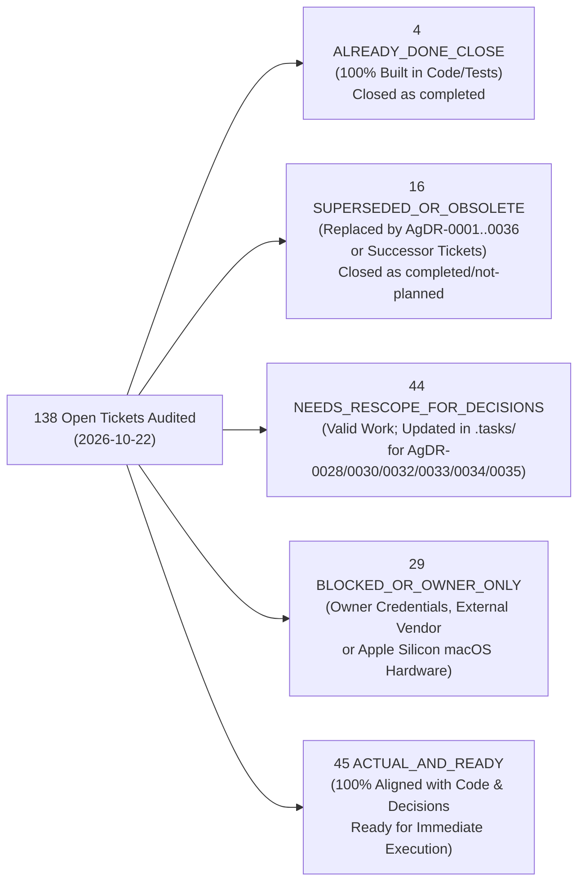

# w0m Estate Ticket Actuality & Decision-Alignment Audit (`138` Open Tickets → `118` Open)

**Date:** `2026-10-22`  
**Scope:** Every open ticket across the 8 remaining open Area Tracks (`area-1`..`area-7`, `area-9`; `area-8` is `14/14` complete) audited against live codebase/migrations reality and the 36 recorded Architectural Decisions (`AgDR-0001`..`AgDR-0036`).

---

## 1. Executive Summary & Disposition Matrix

| Disposition | Count | Action Taken | Tickets |
|---|---:|---|---|
| **`ALREADY_DONE_CLOSE`** | **4** | **Closed (`status: done`, `closed_as: completed`)** | `T32`, `T62`, `T81`, `T374` |
| **`SUPERSEDED_OR_OBSOLETE`** | **16** | **Closed (`status: done`, `closed_as: completed` / `not-planned`)** | `T12`, `T15`, `T31`, `T50`, `T65`, `T116`, `T167`, `T218`, `T293`, `T395`, `T401`, `T423`, `T424`, `T426`, `T441`, `T492` |
| **`NEEDS_RESCOPE_FOR_DECISIONS`** | **44** | **Updated `.tasks/T##.md` ACs, blockers & `## Actuality & Decision Alignment (2026-10-22)`** | **Area 1:** `T454`, `T466`, `T475`, `T66`, `T347` **Area 2:** `T43`, `T531`, `T104` **Area 3:** `T164`, `T259`, `T273`, `T384`, `T400`, `T509`, `T71`, `T76`, `T80`, `T113`, `T343`, `T383`, `T486`, `T487`, `T512`, `T516`, `T522`, `T84` **Area 4:** `T234` **Area 5:** `T36`, `T220`, `T37`, `T109`, `T434` **Area 6:** `T526`, `T10` **Area 7:** `T306`, `T6`, `T61`, `T308`, `T316` **Area 9:** `T57`, `T60`, `T197`, `T274`, `T427` |
| **`BLOCKED_OR_OWNER_ONLY`** | **29** | **Documented exact owner/vendor/hardware dependency** | **Area 1:** `T504`, `T17`, `T28`, `T489` **Area 3:** `T70`, `T355`, `T491`, `T518`, `T521`, `T82`, `T83`, `T184` **Area 4:** `T152`, `T153`, `T171`, `T179`, `T180`, `T368` **Area 5:** `T14` **Area 6:** `T537`, `T98`, `T181`, `T550` **Area 7:** `T264`, `T290`, `T305` **Area 9:** `T136`, `T365`, `T437`, `T438` |
| **`ACTUAL_AND_READY`** | **45** | **Verified ready for immediate execution** | **Area 1:** `T433`, `T459`, `T460`, `T462`, `T479`, `T524`, `T547`, `T490` **Area 2:** `T225`, `T241`, `T278`, `T385`, `T386`, `T408`, `T129`, `T276`, `T328`, `T331`, `T527`, `T549` **Area 3:** `T56`, `T143`, `T226`, `T227`, `T330`, `T480`, `T508`, `T517`, `T519`, `T523`, `T106` **Area 4:** `T565` **Area 5:** `T9`, `T88`, `T128`, `T132`, `T500`, `T11` **Area 7:** `T298`, `T302` **Area 9:** `T271`, `T387`, `T326`, `T340` |

---

## 2. Post-Audit Track Counts (`118` Open Tickets Remaining)

| Track | Title | Before Audit | Closed in Audit | Remaining Open | Actionable Now (Non-Blocked) |
|---|---|---:|---:|---:|---:|
| **`area-1`** | Security, Auth, RBAC & Secret Hygiene | 20 | **3** (`T31`, `T32`, `T65`) | **17** | **13** (`8` ready + `5` rescoped) |
| **`area-2`** | SDLC Gates, Hook Integrity & Test Ratchets | 15 | **0** *(active in `agy-batch`)* | **15** | **15** (`12` ready + `3` rescoped) |
| **`area-3`** | Platform Health, Release Engineering & Dev Tooling | 46 | **9** (`T12`, `T81`, `T116`, `T167`, `T293`, `T374`, `T395`, `T401`, `T492`) | **37** | **29** (`11` ready + `18` rescoped) |
| **`area-4`** | Agent Worktrees, Sandboxes & Multi-Agent Orchestration | 8 | **0** *(15 closed earlier)* | **8** | **2** (`T565` ready + `T234` rescoped; `6` macOS/Tart/MLX bound) |
| **`area-5`** | AI Agent Engine, MLX Inference, WebMCP & Skills | 12 | **0** | **12** | **11** (`6` ready + `5` rescoped; `1` macOS MLX bound) |
| **`area-6`** | Connectors, Upwork, Outreach & External Integrations | 9 | **3** (`T50`, `T218`, `T441`) | **6** | **2** (`T10`, `T526` rescoped; `4` vendor/owner blocked) |
| **`area-7`** | Governed Client Projects, Portals, Contracts & Billing | 12 | **2** (`T15`, `T62`) | **10** | **6** (`2` ready + `4` rescoped; `4` owner/Stripe blocked) |
| **`area-8`** | Design System (`@webomage/ui`), Public Web, Brand & Media | 0 | *14 closed earlier* | **0** | **0** (`100%` complete) |
| **`area-9`** | Platform Operations, Backups, Infra & Market Strategy | 16 | **3** (`T423`, `T424`, `T426`) | **13** | **9** (`4` ready + `5` rescoped; `4` owner/macOS blocked) |
| **Total** | **All 9 Canonical Area Tracks** | **138** | **20** | **118** | **87 Actionable + 31 Blocked/Owner-Only** |

---

## 3. Details on the 20 Closed Tickets (`4` Already Done + `16` Superseded)

### 3.1 `ALREADY_DONE_CLOSE` (4 Tickets)
1. **`T32`** (*Rotate leaked Supabase postgres superuser password* — Area 1): `AC1` (DB password rotated + Infisical updated), `AC3` (`.gitleaks.toml` rule), and `AC4` (`OPENROUTER_API_KEY` revoked) were completed 2026-07-25; `AC2` (git history) is explicitly owned by `T17`/`T504` per the ticket's own status note.
2. **`T62`** (*Cohort Staffing Units Schema & UI* — Area 7): `AC1` & `AC2` were withdrawn 2026-08-11; `AC3` & `AC4` (CP hat switcher UI reading from canonical `hats`/`worn_hats`/`project_roles` per `AgDR-0019` & `AgDR-0028`) are shipped in `SidebarHatSwitcher.svelte`, `HatSwitcher.svelte`, `MyProjectHats.svelte`, and `/api/project/hats.ts`.
3. **`T81`** (*F4 — Origin check on state-changing auth POSTs* — Area 3): `isAllowedOrigin` is implemented in `wom7web/packages/lib/src/auth/handlers.ts:29-44` and enforced on `switch-role.ts`, `impersonate.ts`, and `stop-impersonating`, with passing unit tests in `wom7web/apps/cp/src/tests/api/admin/impersonate.test.ts`.
4. **`T374`** (*Unified oMLX process management* — Area 3): All 4 ACs (`status`, `stop`, `start`/`restart` with port `8888` arbitration in `wom7web/project/scripts/omlx_service.py`, plus `omlx-*` recipes in `@wom/justfile:1185-1195` and `wom7api/justfile:727-738`) were implemented and committed in `0cd4d4a4`.

### 3.2 `SUPERSEDED_OR_OBSOLETE` (16 Tickets)
1. **`T12`** (*Cross-repo tech-debt KB* — Area 3): Proposed writing to `public.tech_debt` in CP, which was explicitly retired and dropped in `20260721140000_retire_tech_debt_census.sql` and `.w0m/sdlc.json -> tech_debt.note` in favor of `TECH-DEBT.md` (`just debt-check`).
2. **`T15`** (*CP people hierarchy scoping* — Area 7): Placeholder ACs superseded and delivered by `AgDR-0019` (`<org>.<unit>` namespace & offices-to-hats unification), `AgDR-0027`, `AgDR-0028` (engagements + minimum hats + collapse), `T458`, `T461`, and `T553` (`wom_staff_hat`, `wom_retract_hat`, `wom_can_read_project_hats`).
3. **`T31`** (*Test admin hygiene* — Area 1): `AC1` & `AC4` (`guard-test-admin.sh`) are done; `AC2` (`test-admin@webomage.com`) was explicitly rejected by `AgDR-0027` / `T458` Q1 (root-only admin `w0m@webomage.com`), and `AC3` (`TEST_ADVENTURER_ID`) was superseded by `AgDR-0022` and `T488`/`T489` (`just test-team-local`).
4. **`T50`** (*Fix Upwork Ingestion Pagination & CLI Search* — Area 6): Cursor pagination was added to `wom7api/scripts/upwork_exporter.ts:320-417`, and the legacy Upwork GraphQL API was subsequently deprecated and replaced by `T537`/`T539`/`T559` + `AgDR-0034` (`upwork_mcp_sync.py --full`).
5. **`T65`** (*Gitpod Cloud Developer Workspaces* — Area 1): `.gitpod.yml` + `npm install` + single port `4321` was superseded by the 8-repo estate workspace architecture (`pnpm@10.32.0`, `AgDR-0032` `just agent-tree`, Infisical secret injection, and `project/ports-policy.json`).
6. **`T116`** (*Consolidate duplicated schemas/models into packages/lib* — Area 3): `AC1`/`AC2`/`AC4` were closed obsolete 2026-07-22; `AC3` (shared Supabase client in `packages/lib`) was delivered by `T202` and `T327` (`@webomage/lib/supabase-clients`).
7. **`T167`** (*Internal JSON Resume registry* — Area 3): Local per-user `.json` resume files were explicitly rejected on 2026-09-29 (`T498`/`T499` owner decision) and superseded by relational `public.profile_cv_facts`, `profile_cv_skills`, `profile_cv_entries`, `profile_experience`, `profile_resumes`, PDF/MD export, and Resume Studio at `job.webomage.com/me/resume` (`T360`–`T560`, `AgDR-0033`).
8. **`T218`** (*Adopt the official Upwork MCP for interactive work — it does NOT replace the API key* — Area 6): Superseded by `T537` (`upwork-mcp-allowlist.ts`), `T539` (`upwork_mcp_sync.py`), `T442` (`project/services-policy.json`), `AgDR-0033` (`wom7ext` clipper), and `AgDR-0034` (which deprecated the Upwork GraphQL API key).
9. **`T293`** (*Members manage their own resume/CV in the CP* — Area 3): Superseded and delivered by Resume Studio at `job.webomage.com/me/resume` (`T360`–`T560`, `AgDR-0033`), private `resumes` bucket RLS + signed URLs, manager/admin read governance (`T545`), and `T525` (`kept-in-org` recruiting CV snapshot).
10. **`T395`** (*Migrate estate-universal config/tooling from wom7web into @wom workspace root* — Area 3): Delivered by `T414` (moving `project/policies/*.json` and `scripts/{discovery,tools_check}.py` to `@wom` root), with remaining shadow symlink removal owned by `T509` U2.
11. **`T401`** (*Client Delivery Stabilization: Pre-release verification checklist and release gate orchestration* — Area 3): Superseded and delivered by `T473` (`release.py` + `just release-verify <version>`), `T503` (`_deploy-chain`), and `T554` (`land_release_record`).
12. **`T423`** (*Orca registry hygiene, rerere installer, and main-checkout commit observer* — Area 9): Superseded by `AgDR-0032` / `T531` (`just agent-tree`).
13. **`T424`** (*Orca as the one worktree factory: orca.yaml setup with computed estate parent shims* — Area 9): Explicitly rejected and superseded by `AgDR-0032` / `T531` (`just agent-tree` full-estate worktree copies in `~/.w0m/work/<name>/w0m`).
14. **`T426`** (*Parallel-agents pilot via Orca* — Area 9): `AC5` (`_in/active-work.json` & `agent_claim.py` removal) completed 2026-09-24; `AC1`–`AC4` superseded and delivered by `AgDR-0032` / `T531` (`just agent-tree`).
15. **`T441`** (*Upwork for every member — extend upwork-poller* — Area 6): Superseded by `T442` (`AgDR-0034` unified OAuth connector framework & AES-256-GCM encrypted `public.connections`), `T537` (per-member Upwork MCP OAuth & deprecation of `upwork-poller`), `T539` (`upwork_mcp_sync.py`), and `T560` (`AgDR-0033` `job.webomage.com/me/connectors`).
16. **`T492`** (*Decouple the estate from wom7web and wom7api* — Area 3): Superseded by `T509` (P1, 17 ACs, U0–U9) and `T446` (`just layout-check` gate).

---

## 4. Cross-Cutting Decision Alignments Applied to Open Tickets

Every remaining open ticket affected by recent architectural decisions now carries an explicit `## Actuality & Decision Alignment (2026-10-22)` section in `.tasks/T##.md` covering six cross-cutting shifts:

1. **`AgDR-0033` (`T560`) — `job.webomage.com` vs `cp.webomage.com` Portal Split**:
   - Affects: `T454`, `T466`, `T66`, `T433`, `T479`, `T43`, `T278`, `T76`, `T80`, `T486`, `T487`, `T220`, `T37`, `T98`.
   - Rule: Member Resume Studio (`/me/resume`), career profile (`/me/work`), marketplace sync (`/me/connectors`), outreach (`/me/outreach`), proposals, messages, recruiting (`/o/[org]/people/recruiting/*`), and commercial contracts (`/o/[org]/money/{contracts,proposals}`) live in `wom7web/apps/job` (`job.webomage.com`), while technical project delivery (`/o/[org]/p/[project]/*`), member identity core (`/me/account`), and platform admin (`/admin/*`) live in `wom7web/apps/cp`.
2. **`AgDR-0030` (`T409`) — `wom7cfworkers` Split into `wom7func` and `wom7api`**:
   - Affects: `T43`, `T259`, `T273`, `T384`, `T400`, `T71`, `T76`, `T113`, `T383`, `T84`, `T37`, `T308`, `T57`, `T60`.
   - Rule: All 19 production Cloudflare Workflows live in `wom7api/src/workflows/` (`wom7api/wrangler.jsonc`), while cron/edge triggers live in `wom7func/`.
3. **`AgDR-0019`, `AgDR-0022`, `AgDR-0027`, `AgDR-0028` (`T458`, `T553`) — Engagements, Hats & `tpm` Retirement**:
   - Affects: `T466`, `T347`, `T328`, `T486`, `T128`, `T306`, `T61`.
   - Rule: Delivery engagements (`<contractor>.<engagement>.<client>`) staff minimum hats `client`, `pm` (`delivery.manager`), and `tl` (`tech-lead`, into which `dev` and `devops` collapse until staffed, and `qa` collapses into `pm`). The legacy `tpm` role/office is prohibited (`T553`).
4. **`AgDR-0034` (`T442`, `T537`) & `AgDR-0035` (`T528`) — Connector & KYC Personal Identity SSOTs**:
   - Affects: `T475`, `T526`, `T220`.
   - Rule: Per-member OAuth tokens live in `public.connections` (AES-256-GCM encrypted via `CONNECTOR_TOKEN_KEY_V1`), not `upwork_auth_tokens`. Personal identity PII (`curp`, `rfc`, `identity_verified_at`) lives in `public.profile_identity` (`profile_id`), not `gamification.compliance_profiles`.
5. **`AgDR-0032` (`T531`) — Isolated Full-Estate Agent Trees (`just agent-tree`)**:
   - Affects: `T408`, `T531`, `T509`, `T343`, `T234`, `T274`, `T427`.
   - Rule: Agents work in full estate copies under `~/.w0m/work/<name>/w0m`, replacing single-repo worktrees and `orca.yaml` parent shims.
6. **Multi-OS Host Awareness (`Linux x86_64` `aleksei@HP` + `macOS Apple Silicon`)**:
   - Affects: `T164`, `T509`, `T343`, `T487`, `T522`, `T84`, `T152`, `T153`, `T171`, `T179`, `T180`, `T368`, `T434`, `T14`, `T181`, `T365`.
   - Rule: Cross-platform scripts (`tools_check.py`, `resource_monitor.py`, `skills_catalogue.py`) must guard `launchd` / `brew` / `simctl` / `tart` checks with `sys.platform == "darwin"` and use test fixtures rather than assuming macOS host paths, while hardware-bound Apple Silicon Metal (`mlx-rs`, `omlx`, `laya-mlx`) and `Virtualization.framework` (`tart`, `apple/container`) runtime ACs are explicitly marked macOS-host-only.
