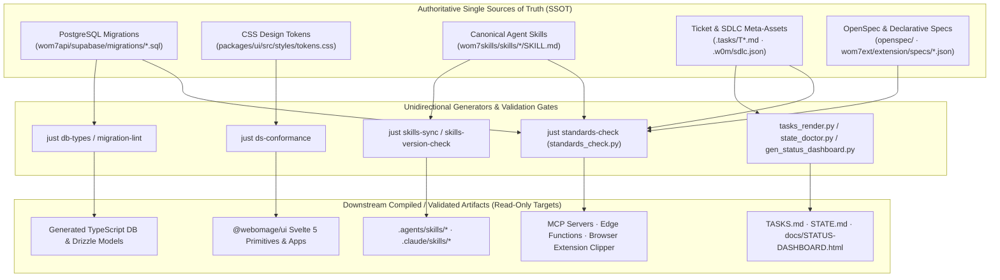

# Single Source of Truth (SSOT) Authority Graph & Unidirectional Flow Rules (`T214` AC2)

> **Companion Diagram:** [`ssot-authority-graph.mmd`](ssot-authority-graph.mmd)
> **Enforced by:** `just standards-check` (`wom7web/project/scripts/standards_check.py`)

## 1. Core Invariant: Strictly One Canonical Origin per Domain

Every data shape, configuration contract, design token, skill definition, and tracking surface in `w0m` has **one authoritative origin (SSOT)** and flows **unidirectionally** to its downstream consumers:

1. **PostgreSQL DDL Migrations (`wom7api/supabase/migrations/*.sql`) $\to$ Database & TypeScript Models**
   - All tables, views, enums, RLS policies, and SQL RPC functions originate in timestamped SQL migrations.
   - Downstream TypeScript database types and Drizzle schemas are derived from the migrations (`just db-types`, `just schema-drift`). Hand-rolled duplicate table interfaces are forbidden.
2. **Design System CSS Custom Properties (`wom7web/packages/ui/src/styles/tokens.css`) $\to$ `@webomage/ui` & Apps**
   - Brand colors, spacing, typography, and elevation tokens are defined once as CSS custom properties (`var(--...)`) and consumed by `@webomage/ui` Svelte 5 primitives (`Button`, `Input`, `Select`, `Badge`, `Card`, `PageHeader`).
   - Hardcoded `#hex` colors and raw HTML `<button>` / `<input>` / `<select>` controls in `apps/cp` are blocked by `just ds-conformance` (`T207`).
3. **Canonical Agent Skills (`wom7skills/skills/*/SKILL.md`) $\to$ Deployed Agent Directories**
   - Every skill is authored once in `wom7skills/skills/*/SKILL.md` (validated against `wom7skills/skills.schema.json`) and synced unidirectionally to `.agents/skills/` and `.claude/skills/`.
   - Out-of-band edits to deployed skill copies are blocked by `just skills-version-check`.
4. **Ticket Files (`.tasks/T*.md`) & `.w0m/sdlc.json` $\to$ Derived Tracking Surfaces**
   - `.tasks/T*.md` YAML frontmatter (validated against `wom7web/project/schemas/meta/ticket-frontmatter.schema.json`) is the single source of truth for ticket status, priority, and AC counts.
   - `TASKS.md` (`tasks_render.py`), `STATE.md` (`state_doctor.py`), and `docs/STATUS-DASHBOARD.html` (`gen_status_dashboard.py`) are compiled deterministically from `.tasks/T*.md` and `.w0m/sdlc.json`.
5. **Declarative Platform & MCP Schemas $\to$ Runtime Adapters**
   - MCP server declarations live in `.w0m/sdlc.json` (`mcp.servers`) and `.mcp.json` (`MCP 2024-11-05`).
   - Browser extension DOM extraction rules live in `wom7ext/extension/specs/*.json` and are validated against the declarative clipper contract.

## 2. Authority Graph Diagram

